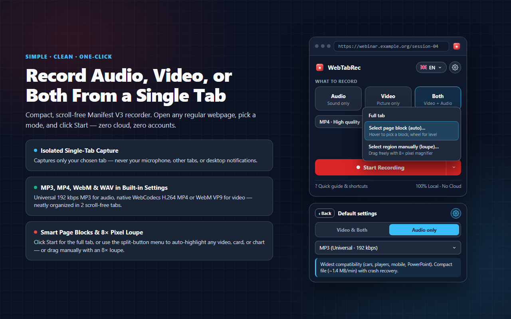
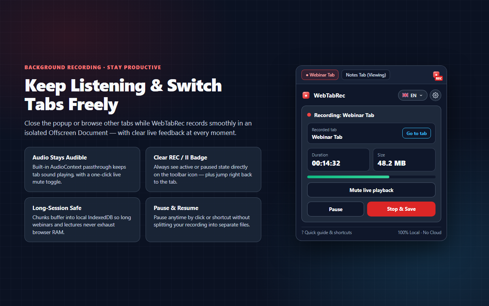
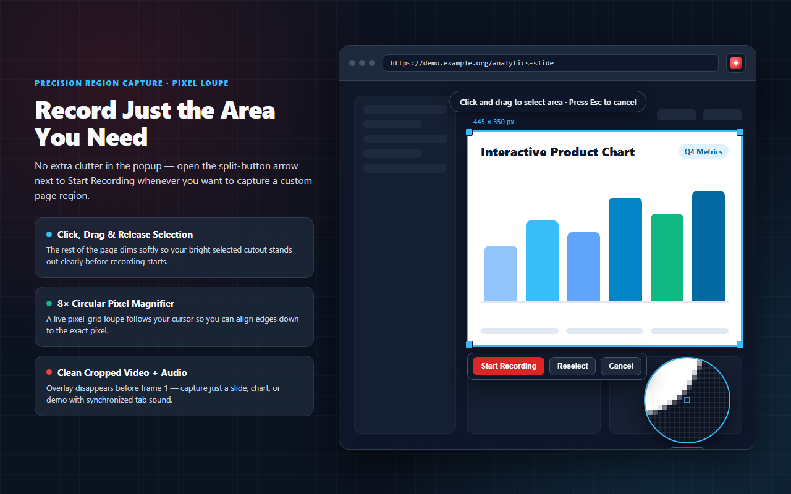
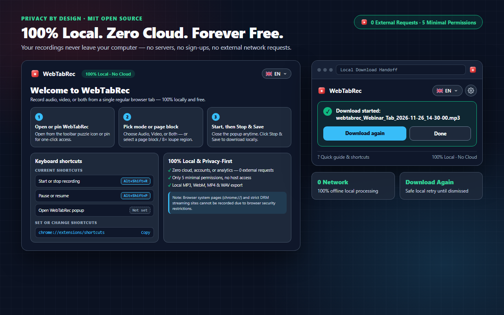
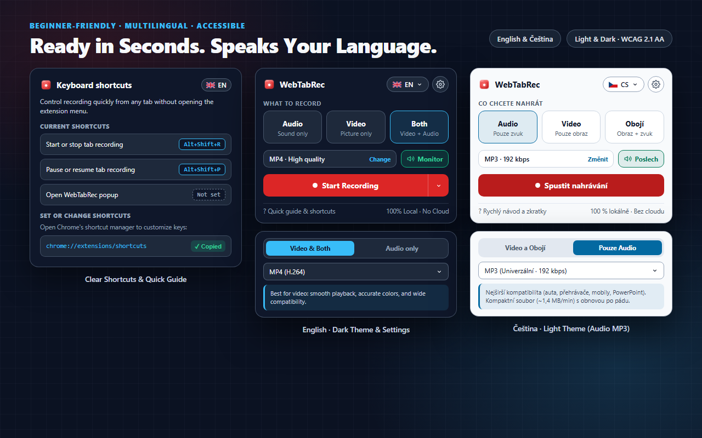

# WebTabRec (Český přehled)

[](https://github.com/zocek/WebTabRec/actions/workflows/ci.yml)
[](LICENSE)

> **Stav projektu:** Implementace `v1.0.0` (Manifest V3) ověřena sadou `357 + 16` automatických testů i živým E2E testem produkčního balíčku `dist/webtabrec-v1.0.0.zip` v Google Chrome `157.0.8103.80` ([protokol ověření](docs/chrome-smoke-test-checklist.md)).

**WebTabRec** je bezplatné open-source rozšíření (licence MIT, Manifest V3) pro lokální nahrávání zvuku, videa nebo obojího z jedné aktivní karty prohlížeče Chrome / Chromium — **100 % lokálně**, bez cloudu, bez registrace, bez vodoznaků, bez časových limitů a s nulovým externím síťovým provozem.

*English documentation (primary): [README.md](README.md)*



<details>
<summary>Další náhledy (Nahrávání na pozadí, Výřez s 8× lupou, Soukromí a Jazyky)</summary>






</details>

---

## Instalace

- **Chrome Web Store:** *Brzy k dispozici (`v1.0.0` připraveno ke schválení).*
- **Ruční instalace z GitHub Releases nebo zdrojového kódu:**
  1. Stáhněte a rozbalte `webtabrec-v1.0.0.zip` ze sekce **Releases** (nebo naklonujte repozitář).
  2. V Google Chrome / Chromium (`116+`) otevřete `chrome://extensions/`.
  3. Zapněte **Režim pro vývojáře** (vpravo nahoře), klikněte na **Načíst rozbalené** a vyberte rozbalenou složku.

---

## Funkce (v1.0.0)

- **Tři režimy záznamu jedné karty a vestavěné Výchozí nastavení:** Pouze Audio (univerzální lokální `MP3 192 kbps`, kompaktní `WebM Opus` nebo nekomprimovaný `WAV`), pouze Video (`WebM` / nativní `MP4 H.264`), nebo synchronizované Video + Audio. Kompaktní hlavní panel (~290 px bez posuvníku) spojuje rychlý výběr režimu, přepínač poslechu s ikonou reproduktoru a vlajkový výběr jazyka s vestavěným 2kartovým pohledem *Výchozí nastavení* (*Video a Obojí* / *Pouze Audio*, rovněž bez posuvníku) pro formáty a adaptivní kvalitu videa (**Standardní** / **Vysoká**).
- **Chytrý výběr bloků stránky i ruční výřez s lupou:** V režimu **Video** nebo **Obojí** rozbalíš šipkou u tlačítka *Spustit nahrávání* volbu *Vybrat blok stránky (automaticky)…* (najetím označíš video, kartu, tabulku či rámec; kolečkem myši, šipkami `↑` `↓` nebo tlačítky `▲ Širší` / `▼ Užší` plynule měníš úroveň v hierarchii) nebo *Vybrat výřez ručně (lupa)…* s **8× kruhovou pixelovou lupou**.
- **Zachovaný poslech zvuku:** Díky `AudioContext` + `GainNode` karta při nahrávání neztichne a poslech lze za běhu kdykoli ztlumit.
- **Nahrávání na pozadí:** Popup lze zavřít nebo přepnout na jinou kartu — záznam pokračuje s jasným odznakem `REC` / `II` na ikoně a rychlým přepnutím zpět na nahrávanou kartu.
- **100 % lokální úložiště a bezpečný export:** Bloky se ukládají do lokální `IndexedDB` (`webtabrec_db`) bez zahlcení RAM, s okamžitým přetáčením ve WebM i MP4, bezpečným zachováním pro *Stáhnout znovu* a best-effort obnovou po pádu prohlížeče pro `MP3`, `WebM` a `WAV` (nativní WebCodecs `MP4` vyžaduje řádné ukončení a obnovu po pádu nepodporuje).
- **Srozumitelnost pro běžného uživatele:** Přehledné rozhraní (světlý i tmavý režim, kontrast WCAG 2.1 AA) a jednorázový lokální průvodce ihned po instalaci s 3krokovým návodem, přehledem klávesových zkratek a souhrnem soukromí.
- **Vícejazyčnost (i18n):** Angličtina (`en`) a čeština (`cs`) v základu (157 ověřených klíčů), snadné přidání dalších jazyků.

## Lokální testování a balení

WebTabRec nepoužívá žádné runtime závislosti ani bundler (čisté ES moduly; pro testy a balení postačí Node.js `>= 22`):

```bash
# Kontrola překladů EN/CS + všech 355 jednotkových a E2E testů
npm run check

# Sestavení čistého ZIP balíčku pro Chrome Web Store (dist/webtabrec-v1.0.0.zip)
npm run package
```

Pro spuštění v Google Chrome otevři `chrome://extensions/`, zapni **Režim pro vývojáře**, klikni na **Načíst rozbalené** a vyber kořenovou složku repozitáře.

## Rozsah, omezení a odpovědné používání

- **Izolace jedné karty:** Nenahrává mikrofon, ostatní karty ani notifikace operačního systému.
- **Omezení prohlížeče:** Systémové stránky (`chrome://`, `edge://`, `devtools://`, Chrome Web Store) a přísně chráněný DRM obsah prohlížeč nahrávat neumožňuje.
- **Technické limity:** Bez časových limitů; délka je omezena pouze volným místem na disku a u formátu WAV technickým limitem hlavičky RIFF (bezpečné automatické uložení pod 2 GB).
- **Odpovědné používání:** Respektujte autorská práva, podmínky webových služeb a souhlas ostatních účastníků při záznamu hovorů či prezentací.

## Dokumentace projektu

| Oblast | Uživatelský přehled (Vrstva 1) | Technická specifikace (Vrstva 2 · SSOT) |
|---|---|---|
| **Architektura a koncepce** | [docs/concept-and-architecture.md](docs/concept-and-architecture.md) | [docs/specs/architecture.spec.md](docs/specs/architecture.spec.md) |
| **Design, UX a lokalizace** | [docs/design-and-ux.md](docs/design-and-ux.md) | [docs/specs/design-ui.spec.md](docs/specs/design-ui.spec.md) |
| **Karta ve Store, SEO & AI dohledatelnost** | [docs/store-listing.md](docs/store-listing.md) | [docs/specs/store-discoverability.spec.md](docs/specs/store-discoverability.spec.md) |
| **Publikace do Chrome Web Store** | [docs/chrome-web-store-publishing.md](docs/chrome-web-store-publishing.md) · [Ruční smoke testy v Chrome](docs/chrome-smoke-test-checklist.md) | [docs/specs/publishing.spec.md](docs/specs/publishing.spec.md) |
| **Architektonická rozhodnutí (ADR)** | [ADR-0001](docs/adr/0001-local-download-handoff.md) · [ADR-0002](docs/adr/0002-region-video-capture.md) · [ADR-0003](docs/adr/0003-webcodecs-mp4-encoder.md) · [ADR-0004](docs/adr/0004-local-mp3-audio-encoder.md) | [docs/adr/0000-template.md](docs/adr/0000-template.md) |

## Licence

Projekt je šířen pod licencí **MIT** — viz [LICENSE](LICENSE).
