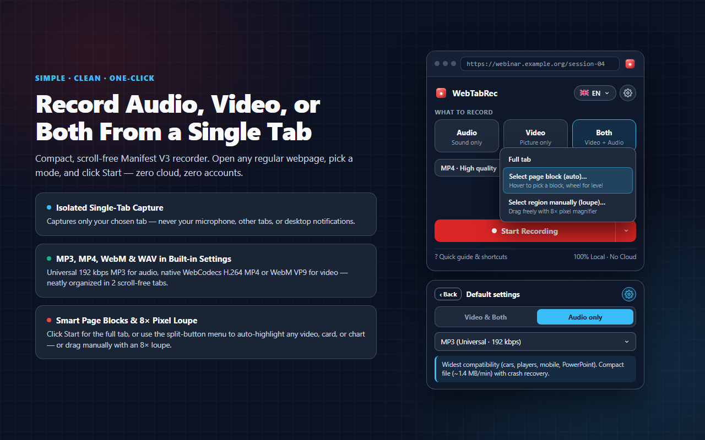
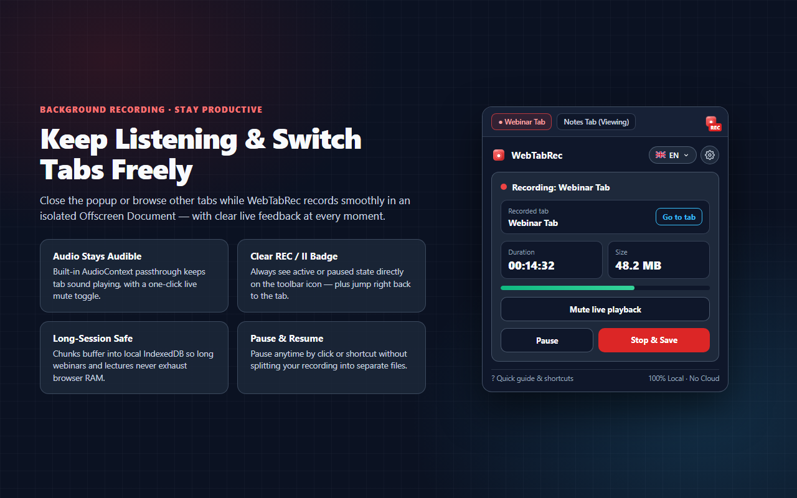
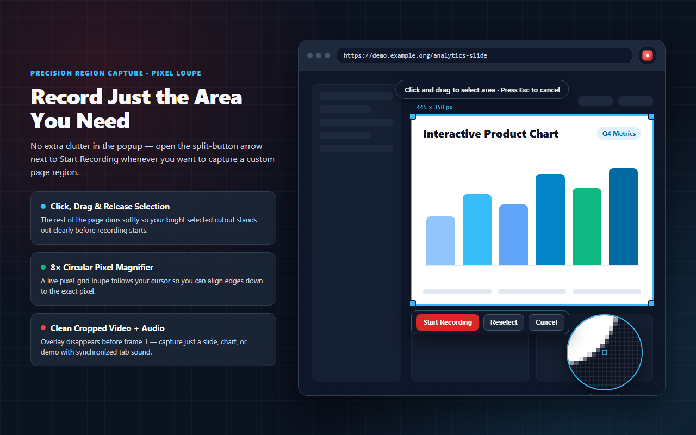
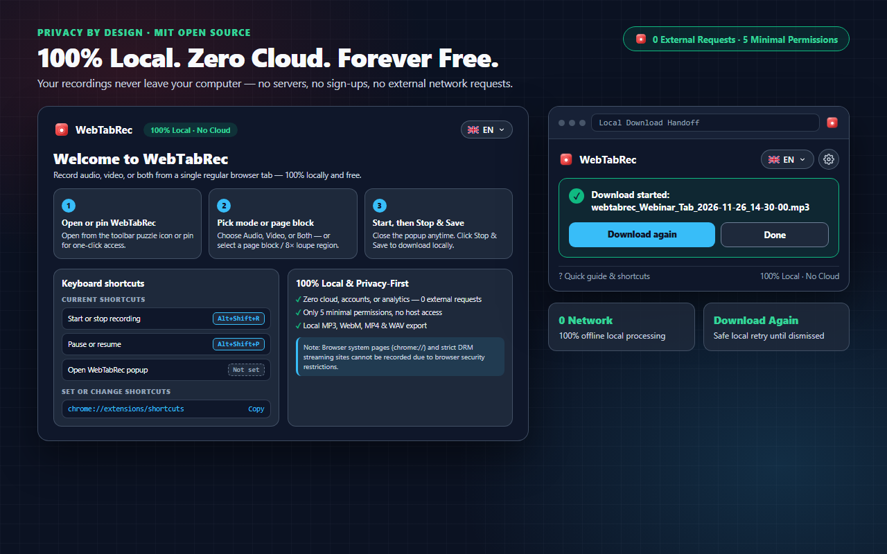
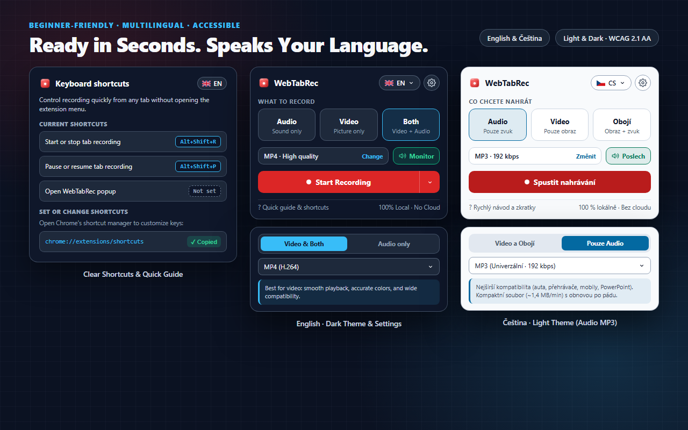

# WebTabRec

[](https://github.com/zocek/WebTabRec/actions/workflows/ci.yml)
[](LICENSE)

> **Status:** `v1.0.0` Manifest V3 implementation verified via `357 + 16` automated tests and live Google Chrome `157.0.8103.80` end-to-end testing against `dist/webtabrec-v1.0.0.zip` ([verification log](docs/chrome-smoke-test-checklist.md)).

**WebTabRec** is a free, MIT-licensed open-source Manifest V3 browser extension for recording audio, video, or both from a single Chrome/Chromium tab 100% locally — with no cloud servers, no accounts, no watermarks, no time limits, and zero external network requests.

*Česká verze dokumentace: [README.cs.md](README.cs.md)*



<details>
<summary>More screenshots (Background Recording, Region Loupe, Welcome &amp; Languages)</summary>






</details>

---

## Installation

- **Chrome Web Store:** *Coming soon (`v1.0.0` pending review).*
- **Manual install from GitHub Release or source:**
  1. Download and unzip `webtabrec-v1.0.0.zip` from **GitHub Releases** (or clone this repository).
  2. Open `chrome://extensions/` in Google Chrome / Chromium (`116+`).
  3. Enable **Developer mode** (top right), click **Load unpacked**, and select the unzipped folder.

---

## Features (v1.0.0)

- **Three focused single-tab modes & built-in Default Settings:** Record **Audio only** (universal pure-JS `MP3 192 kbps`, compact `WebM Opus`, or uncompressed `WAV`), **Video only** (`WebM` or native `MP4 H.264`), or synchronized **Video + Audio** from one specific browser tab. A compact main panel (~290 px, zero scrolling) pairs one-click mode selection, a quick speaker monitoring toggle, and a flag-based language picker with an in-popup 2-tab *Default Settings* view (*Video & Both* / *Audio only*, zero scrolling) for format and adaptive video quality presets (**Standard** / **High**).
- **Smart page-block & pixel-accurate region recording:** In **Video** or **Both** mode, click the split-button arrow next to *Start Recording* to either **automatically pick a logical page block** (hover to highlight video players, cards, tables, or iframes; scroll wheel / `↑` `↓` / `▲ Wider` `▼ Narrower` to step up or down the hierarchy) or **drag a manual pixel region** with an **8× circular pixel-level magnifier loupe**.
- **Keep listening while recording:** Built-in `AudioContext` + `GainNode` passthrough keeps tab sound audible during capture, with a live mute/unmute toggle.
- **Reliable background recording:** Close the popup or switch to other tabs while recording continues with a clear `REC` / `II` toolbar badge and quick jump back to the recorded tab.
- **100% local storage & safe export:** Media chunks buffer into local `IndexedDB` (`webtabrec_db`) to prevent RAM exhaustion, with instant seekable WebM/MP4 exports, safe unconfirmed-download retention (*Download again* option), and best-effort crash recovery for `MP3`, `WebM`, and `WAV` (native WebCodecs `MP4` requires normal *Stop & Save* and does not support crash recovery).
- **Zero-friction beginner UX:** Clean, WCAG 2.1 AA-compliant Light & Dark UI plus a one-time local Welcome guide right after installation with clear 3-step onboarding, live keyboard shortcut overview, and privacy summary.
- **Multilingual (i18n):** English (`en`) and Czech (`cs`) included out of the box (157 verified keys), with an extensible architecture for community translations.

---

## Local Testing & Packaging

WebTabRec uses zero runtime or bundler dependencies (pure ES Modules, Node.js `>= 22` for tests and packaging):

```bash
# Validate EN/CS locales + run all 355 unit & E2E tests
npm run check

# Build auditable Chrome Web Store ZIP (dist/webtabrec-v1.0.0.zip)
npm run package
```

To try it locally in Google Chrome, open `chrome://extensions/`, enable **Developer mode**, click **Load unpacked**, and select the repository root folder.

---

## Scope, Browser Limits & Responsible Use

To stay transparent for both users and automated tools, here is what WebTabRec **does not** do:
- **Single tab only:** It isolates one browser tab — it does not capture your microphone, other tabs, or desktop notifications.
- **Browser-restricted pages:** Chrome blocks capture on system pages (`chrome://`, `edge://`, `devtools://`, `chrome-extension://`, browser settings, and Chrome Web Store).
- **DRM content:** Sites using strict hardware/EME DRM may block video or audio capture at the browser level.
- **Format & storage boundaries:** No time limits are imposed, though recording length is bounded by local disk quota and standard RIFF/WAV file-size ceilings (auto-saved safely below 2 GB for WAV).
- **Responsible use:** Please use WebTabRec responsibly — respect copyright laws, platform terms of service, and obtain consent before recording meetings or other people.

---

## Frequently Asked Questions (FAQ)

- **Does WebTabRec upload anything to the cloud?**  
  No. WebTabRec makes zero external network requests. All recording, buffering, and file saving happen strictly inside your local browser.
- **Will the tab go silent while I record its audio?**  
  No. Audio passthrough keeps playing the tab's sound to your speakers while recording, and you can mute or unmute live playback at any time.
- **Can I switch to another tab or close the popup while recording?**  
  Yes. Recording runs inside a Manifest V3 Offscreen Document, so closing the popup or working in other tabs does not interrupt capture.
- **What permissions does WebTabRec request?**  
  Only five minimal permissions: `tabCapture`, `offscreen`, `activeTab`, `storage`, and `scripting` (strictly on-demand for the region-selection overlay via `activeTab`, with zero install-time host warnings). It never requests `<all_urls>`, `host_permissions`, `tabs`, or browsing history access.

---

## Project Documentation (Two-Layer Standard)

| Area | User Overview (Layer 1) | Technical Specification (Layer 2 · SSOT) |
|---|---|---|
| **Architecture & MV3 Engine** | [docs/concept-and-architecture.md](docs/concept-and-architecture.md) | [docs/specs/architecture.spec.md](docs/specs/architecture.spec.md) |
| **Design, UX & Localization** | [docs/design-and-ux.md](docs/design-and-ux.md) | [docs/specs/design-ui.spec.md](docs/specs/design-ui.spec.md) |
| **Store Listing, SEO & AI Discoverability** | [docs/store-listing.md](docs/store-listing.md) | [docs/specs/store-discoverability.spec.md](docs/specs/store-discoverability.spec.md) |
| **Chrome Web Store Publishing** | [docs/chrome-web-store-publishing.md](docs/chrome-web-store-publishing.md) · [Smoke Test Checklist](docs/chrome-smoke-test-checklist.md) | [docs/specs/publishing.spec.md](docs/specs/publishing.spec.md) |
| **Architecture Decisions (ADRs)** | [ADR-0001](docs/adr/0001-local-download-handoff.md) · [ADR-0002](docs/adr/0002-region-video-capture.md) · [ADR-0003](docs/adr/0003-webcodecs-mp4-encoder.md) · [ADR-0004](docs/adr/0004-local-mp3-audio-encoder.md) | [docs/adr/0000-template.md](docs/adr/0000-template.md) |

---

## Governance, Privacy & Assets

- [AGENTS.md](AGENTS.md) — Engineering constraints, MV3 rules, and quality gates.
- [CONTRIBUTING.md](CONTRIBUTING.md) — Local development, adding translations, and PR workflow.
- [PRIVACY.md](PRIVACY.md) — Bilingual (EN + CS) Privacy Policy.
- [SECURITY.md](SECURITY.md) — Responsible security vulnerability reporting.
- [CODE_OF_CONDUCT.md](CODE_OF_CONDUCT.md) — Community standards.
- [CHANGELOG.md](CHANGELOG.md) — Version history.
- `assets/icons/` — Source vector icon (`icon.svg`) and raster icons (`16`, `32`, `48`, `128 px`).
- `store/assets/` — Chrome Web Store graphics (24-bit opaque RGB PNGs: 5 `1280×800` screenshots generated from the implemented `v1.0.0` UI, plus Small `440×280` and Marquee `1400×560` promo tiles).

## License

Released under the **MIT License** — see [LICENSE](LICENSE).
