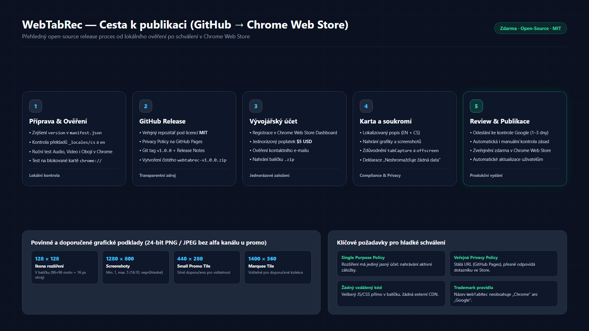

# WebTabRec — Návod k publikaci do Chrome Web Store

> **Technická specifikace (Vrstva 2 · SSOT):** [specs/publishing.spec.md](specs/publishing.spec.md)  
> **Související dokumenty:** [Karta ve Store, texty a SEO](store-listing.md) · [Koncepce a architektura](concept-and-architecture.md) · [Design a lokalizace](design-and-ux.md)

Tento návod pokrývá celý proces zveřejnění **WebTabRec** jako bezplatného open-source rozšíření — od přípravy GitHub repozitáře až po schválení, aktualizace a bezpečný rollback v Chrome Web Store.

---

## 1. Co si připravit před první publikací

1. **Veřejný GitHub repozitář** pod licencí **MIT** s aktuálním kódem, `README.md`, `PRIVACY.md` a `SECURITY.md` (se zapnutým *Private Vulnerability Reporting*).
2. **Veřejná trvalá URL pro Zásady ochrany osobních údajů (Privacy Policy):**
   - Nejjednodušší varianta zdarma je přímý trvalý odkaz na [PRIVACY.md](../PRIVACY.md) ve veřejném GitHub repozitáři nebo publikovaná stránka na **GitHub Pages** (nikoli sdílený Google Doc).
3. **Google Developer účet pro Chrome Web Store:**
   - Založení na [Chrome Web Store Developer Dashboard](https://chrome.google.com/webstore/devconsole).
   - Zapni povinné **dvoufázové ověření (2FA)** na svém Google účtu.
   - Jednorázový registrační poplatek činí **$5 USD** (platí se jednou za celý vývojářský účet).
   - Vyplň a ověř kontaktní e-mail v sekci **Account**.
4. **Grafické podklady pro kartu ve Store:**
   - Ikony v `assets/icons/` (`16`, `32`, `48`, `128 × 128 px` — pouze PNG součást balíčku; `icon.svg` nebalit).
   - 5 screenshotů `1280 × 800 px` (24-bit RGB PNG bez průhlednosti) v `store/assets/` vygenerovaných z implementovaného UI `v1.0.0` (před finálním odesláním volitelně doplnit živé snímky z Chrome nebo CS variantu).
   - Small Promo Tile `440 × 280 px` a Marquee Promo Tile `1400 × 560 px` v `store/assets/` (24-bit RGB PNG bez průhlednosti).

---

## 2. Krok za krokem: První vydání (v1.0.0)

### Krok 1 — Zkontroluj, otestuj a zabal čistý balíček
- Zkontroluj číslo verze v `manifest.json` (`1.0.0`) a spusť kontrolu překladů (`validate-locales.mjs`) i PNG IHDR kontrolu.
- Vytvoř čistý ZIP archiv (`webtabrec-v1.0.0.zip`), který obsahuje **pouze runtime soubory** (`manifest.json`, `_locales/`, `assets/icons/icon-*.png`, `src/`, `LICENSE`) — **bez** složek `.git/`, `docs/`, `store/`, `scripts/` a bez `icon.svg`.
- Rozbal ZIP do dočasné složky a projdi celý Release Gate v Chrome 116 i aktuálním Chrome Stable podle [kontrolního seznamu ručního testování v Chrome](chrome-smoke-test-checklist.md) (včetně opakovaných stažení, *Ptát se kam uložit*, blokovaných karet a kontroly Network v Popup, Welcome, Offscreen i Service Workeru).

### Krok 2 — Vytvoř GitHub Release
- Vytvoř Git tag `v1.0.0`, publikuj GitHub Release s přehledem funkcí a přilož stejný soubor `webtabrec-v1.0.0.zip`, aby si kdokoli mohl ověřit shodu balíčku se zdrojovým kódem.

### Krok 3 — Nahraj balíček a vyplň Store Listing
1. V Developer Console klikni na **+ New Item** a nahraj `webtabrec-v1.0.0.zip`.
2. V sekci **Store Listing** použij připravené podklady z [docs/store-listing.md](store-listing.md):
   - **Popis a lokalizace:** Store automaticky rozpozná jazyky z `_locales/` (`en`, `cs`). Vlož připravený anglický i český podrobný popis.
   - **Kategorie (Primary Category):** **`Tools`** *(ve skupině Productivity)*.
   - **Grafika:** Nahraj finální autentické screenshoty (`1280 × 800`), Small Promo Tile (`440 × 280`) a volitelně Marquee Promo Tile (`1400 × 560`).
   - **Odkaz na web / podporu:** Odkaz na GitHub repozitář a GitHub Issues.

### Krok 4 — Vyplň sekci Privacy (klíčové pro hladké schválení)
1. **Single purpose:** Popiš jediný jasný účel rozšíření (lokální nahrávání jedné aktivní karty).
2. **Permission justifications:** Ke každému oprávnění (`tabCapture`, `offscreen`, `activeTab`, `storage`, `scripting`) vlož připravené anglické zdůvodnění z [technické specifikace publikace](specs/publishing.spec.md).
3. **Remote code:** Zvol **No** (veškerý kód je přímo v balíčku).
4. **Data usage & Privacy Policy:** Vyplň sekci podle **Data Flow Disclosure Map** v [specs/publishing.spec.md](specs/publishing.spec.md) (odlišení lokálního zpracování na zařízení od nulového sběru/přenosu vývojářem, ověřené proti aktuálnímu Chrome Web Store User Data FAQ) a vlož trvalou veřejnou URL na [PRIVACY.md](../PRIVACY.md).

### Krok 5 — Nastav distribuci a odešli ke kontrole
- V sekci **Distribution** zvol **Public** (veřejné, zdarma, všechny regiony).
- Klikni na **Submit for review**. Kontrola Google u čistých Manifest V3 rozšíření obvykle trvá **1 až 3 pracovní dny**, ale u manuální kontroly může trvat i déle (1–2 týdny).

---

## 3. Automatizované vydávání přes GitHub Actions a Chrome Web Store API v2

Po prvním ručním založení položky (`v1.0.0`) v Chrome Web Store Developer Dashboardu zajišťuje všechna další vydání workflow [`.github/workflows/release.yml`](../.github/workflows/release.yml) společně s nulově závislým skriptem [`scripts/publish-cws.mjs`](../scripts/publish-cws.mjs):

1. **Automatický GitHub Release:** Každý push tagu `vX.Y.Z` (nebo ruční spuštění *Actions → Release & Chrome Web Store → Run workflow*) ověří shodu verze s `manifest.json`, spustí kompletní testovací sadu včetně `ffmpeg` MP3 kontroly, sestaví deterministický ZIP + `SHA256SUMS.txt` a vytvoří/aktualizuje GitHub Release.
2. **Automatické nahrání do Chrome Web Store (API v2):** Jakmile v GitHub repozitáři (*Settings → Secrets and variables → Actions*, ideálně v Environmentu `chrome-web-store`) doplníš tři tajné hodnoty (`CHROME_PUBLISHER_ID`, `CHROME_EXTENSION_ID`, `CHROME_SERVICE_ACCOUNT_JSON`), workflow automaticky nahraje ověřený ZIP přes Google Service Account (výchozí režim `draft` pro bezpečnou kontrolu v Dashboardu; volitelně `staged` nebo `publish`). Dokud nejsou tajné hodnoty nastaveny, krok se čistě přeskočí bez ovlivnění GitHub Release.

---

## 4. Aktualizace a bezpečný Rollback

1. Zvyš `version` v `manifest.json` (Chrome vyžaduje pokaždé vyšší číslo) a doplň [CHANGELOG.md](../CHANGELOG.md).
2. Projdi Release Gate a vytvoř + pushni nový anotovaný Git tag (`git tag -a vX.Y.Z -m "WebTabRec vX.Y.Z" && git push origin vX.Y.Z`) — workflow automaticky publikuje GitHub Release a (pokud jsou nastaveny CWS Secrets) nahraje balíček do Chrome Web Store.
3. **Rychlý Rollback při závažné chybě:** V Chrome Web Store Developer Dashboard nejprve využij vestavěnou funkci **Rollback** (pokud je pro předchozí verzi dostupná), a poté srovnej historii v Gitu (`revert` + řádná patch verze).

Detailní publikační checklist, mapu toků dat pro Privacy formulář, anglické texty k přímému zkopírování, konfiguraci Chrome Web Store API v2 a tabulku grafických rozměrů najdeš v [technické specifikaci publikace](specs/publishing.spec.md).
