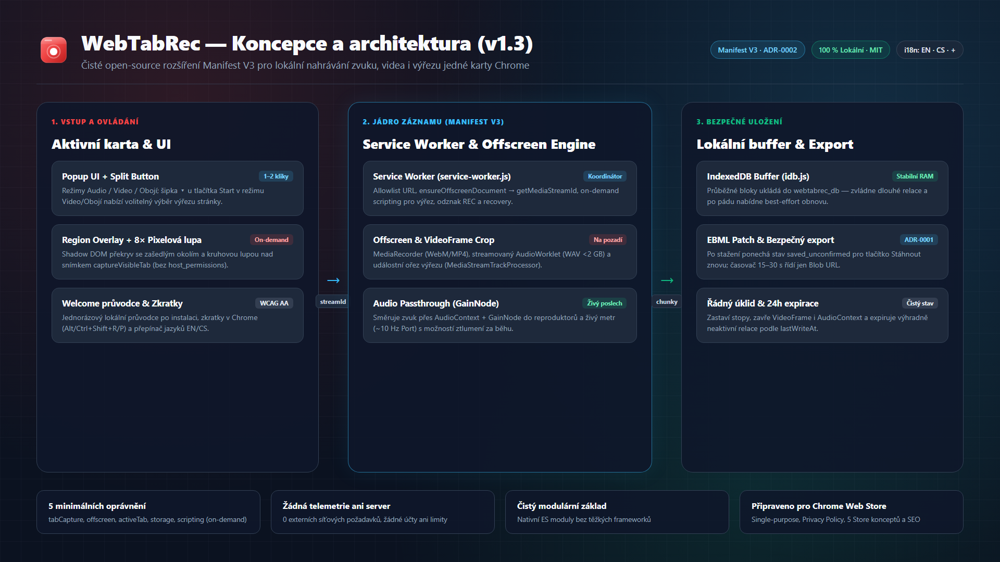

# WebTabRec — Koncepce a architektura řešení

> **Technická specifikace (Vrstva 2 · SSOT):** [specs/architecture.spec.md](specs/architecture.spec.md)  
> **Architektonická rozhodnutí:** [ADR-0001: Lokální handoff stažení](adr/0001-local-download-handoff.md) · [ADR-0002: Výřez stránky a pixelová lupa](adr/0002-region-video-capture.md) · [ADR-0003: Nativní WebCodecs MP4 enkodér](adr/0003-webcodecs-mp4-encoder.md) · [ADR-0004: Lokální MP3 enkodér](adr/0004-local-mp3-audio-encoder.md)  
> **Související dokumenty:** [Design a lokalizace](design-and-ux.md) · [Karta ve Store a SEO](store-listing.md) · [Publikace do Chrome Web Store](chrome-web-store-publishing.md)

## 1. Koncepce a cíle projektu

**WebTabRec** je lehké, bezplatné a plně **open-source** rozšíření pro Google Chrome (Manifest V3), které umožňuje nahrávat obsah jedné konkrétní karty — **pouze zvuk**, **pouze obraz**, nebo **obraz i zvuk současně**.

### Hlavní pilíře řešení
- **100 % lokální zpracování (Privacy-first):** Žádné servery, žádný cloud, žádné uživatelské účty, nulová telemetrie a 0 externích síťových požadavků.
- **Žádné umělé limity:** Bez umělého omezení délky nahrávky, bez vodoznaků a bez skrytých paywallů (omezeno pouze volným úložištěm zařízení a u formátu WAV technickým limitem hlavičky RIFF ~2 GB).
- **Izolace jedné karty:** Zachytává se výhradně zvolená karta prohlížeče — bez mikrofonu, bez zvuků z ostatních karet a bez notifikací operačního systému.
- **Čistý auditovatelný kód:** Minimalistická modulární architektura v čistém JavaScriptu (ES moduly) bez těžkých frameworků a bez vzdáleného kódu.
- **Vícejazyčnost od prvního dne:** Angličtina a čeština v základu s architekturou připravenou na snadné rozšiřování o další jazyky.

---

## 2. Tři režimy záznamu

| Režim | Co se nahrává | Výchozí formát | Typické legitimní použití |
|---|---|---|---|
| **Audio** | Pouze zvuk aktivní karty | **MP3 (192 kbps)** *(lokální pure-JS enkodér v Workeru; volitelně kompaktní WebM Opus nebo nekomprimovaný WAV přes streamovaný PCM)* | Podcasty, přednášky, webináře, jazykové lekce, hlasové poznámky |
| **Video** | Pouze obraz (celá karta, chytrý blok stránky nebo ruční výřez) | WebM (VP9) nebo nativní MP4 (H.264) *(dle podpory prohlížeče)* | Ukázky rozhraní, hlášení chyb, záznam konkrétního prvku nebo grafu |
| **Video + Audio** | Synchronizovaný obraz (celá karta nebo výřez) i zvuk karty | WebM (VP9 + Opus) nebo nativní MP4 (H.264 + AAC) *(dle podpory prohlížeče)* | Online školení, produktová dema, záznamy prezentací a slidů |

---

## 3. Jak architektura funguje v praxi

Rozšíření plně respektuje moderní bezpečnostní model **Manifest V3**, kde pozadí běží jako efemérní Service Worker:

1. **Popup UI & první spuštění:** Při první instalaci se jednou otevře stručný lokální průvodce (`src/welcome/`). Při každodenním použití uživatel zvolí režim v kompaktním hlavním panelu a spustí záznam jedním kliknutím (nebo zkratkou `Alt + Shift + R` v Chrome). Popup po spuštění může kdykoli zavřít nebo přepnout na jinou kartu.
2. **Service Worker (`service-worker.js`):** Ověří, že aktivní karta je běžná webová stránka, nejprve připraví Offscreen dokument a teprve pak vyžádá přes `chrome.tabCapture` krátkodobý token streamu (`streamId`). Na ikoně zobrazí odznak `REC`.
3. **Offscreen Document (`offscreen.js`):** Běží stabilně na pozadí a provozuje nativní **WebCodecs H.264/AAC-LC MP4** enkodér s zero-copy GPU ořezem a faststart muxerem ([ADR-0003](adr/0003-webcodecs-mp4-encoder.md)), lokální pure-JS **MP3 (192 kbps)** enkodér v samostatném Web Workeru ([ADR-0004](adr/0004-local-mp3-audio-encoder.md)), `MediaRecorder` pro WebM (VP9/Opus) i zálohu MP4, případně streamovaný `AudioWorklet` pro nekomprimovaný WAV. Datový tok videa se automaticky škáluje podle skutečného rozlišení záznamu či výřezu. U režimů se zvukem zároveň přes `AudioContext` a `GainNode` vrací zvuk zpět do reproduktorů, takže uživatel kartu během nahrávání dál normálně slyší (a může si poslech kdykoli ztlumit).
4. **IndexedDB Buffer, bezpečný export a obnova:** Během nahrávání se bloky dat průběžně ukládají lokálně do IndexedDB (`webtabrec_db`), takže prohlížeči nedojde operační paměť. Po zastavení se počká na dokončení všech zápisů, spustí se lokální stažení a dočasná kopie zůstane krátce připravená pro tlačítko *Stáhnout znovu* (viz [ADR-0001](adr/0001-local-download-handoff.md)), dokud ji uživatel nepotvrdí nebo neuplyne 24 h. Při pádu prohlížeče nabídne rozšíření best-effort obnovu (pro `MP3`, `WebM` i `WAV`).

---

## 4. Bezpečnost, oprávnění a známá omezení

Rozšíření vyžaduje pouze pět minimálních oprávnění (`tabCapture`, `offscreen`, `activeTab`, `storage`, `scripting` pro on-demand výběr výřezu — bez `host_permissions` a bez varování při instalaci) — nepožaduje přístup ke všem webům ani čtení historie.

- **Povinná akce uživatele:** Nahrávání nelze spustit skrytě na pozadí bez vědomí uživatele; Chrome vždy zobrazí nativní indikátor zachytávání na nahrávané kartě.
- **Systémové stránky:** Stránky mimo běžné `http(s):` / `file:` (např. `chrome://`, `edge://`, `devtools://` a Chrome Web Store) prohlížeč z bezpečnostních důvodů nahrávat neumožňuje.
- **Chráněný DRM obsah a odpovědné používání:** U streamovacích služeb s přísným DRM může prohlížeč zablokovat zachycení obrazu nebo zvuku. Uživatelé musí respektovat autorská práva a souhlas nahrávaných osob.

Podrobné sekvenční diagramy, kontrakty zpráv, schéma IndexedDB, streamovaný PCM WAV a hraniční stavy najdeš v [technické specifikaci architektury](specs/architecture.spec.md).
