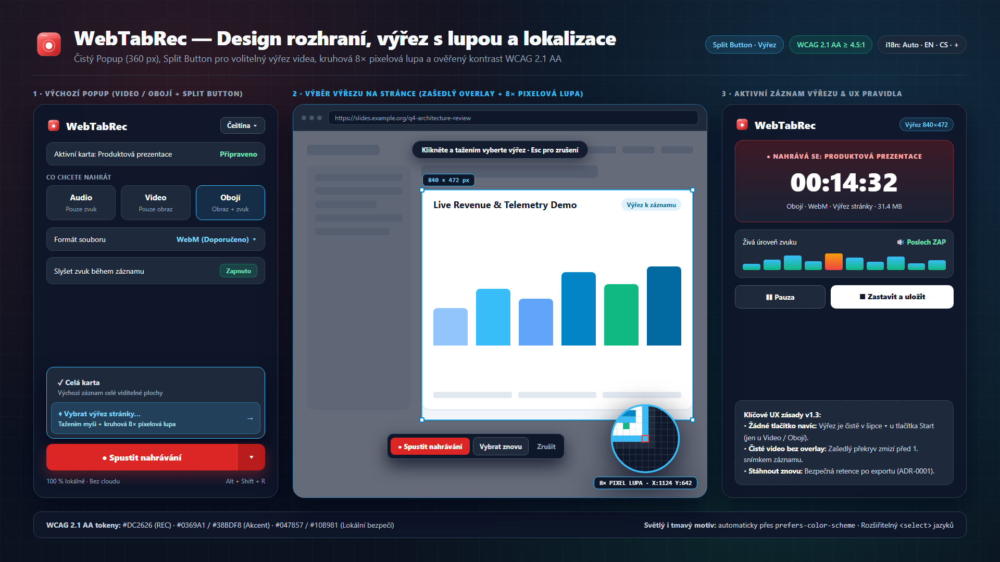

# WebTabRec — Design, UX a lokalizace (i18n)

> **Technická specifikace (Vrstva 2 · SSOT):** [specs/design-ui.spec.md](specs/design-ui.spec.md)  
> **Související dokumenty:** [Koncepce a architektura](concept-and-architecture.md) · [Karta ve Store a SEO](store-listing.md) · [Publikace do Chrome Web Store](chrome-web-store-publishing.md)

## 1. Filozofie rozhraní pro běžného uživatele

Rozhraní **WebTabRec** cílí na okamžitou srozumitelnost hned po instalaci — bez složitých nastavení a bez technického žargonu:

- **Snadný první krok po instalaci:** Chrome nově nainstalovaná rozšíření skrývá pod ikonou puzzle. Proto WebTabRec po instalaci jednou otevře čistý lokální průvodce (`src/welcome/`) se sjednoceným vlajkovým přepínačem jazyka, 3 očíslovanými kroky s ikonami, přehledně rozdělenou kartou klávesových zkratek (*Aktuální nastavení* s lidskými popisky akcí + *Nastavení a úprava zkratek* s kopírováním adresy) a souhrnem záruk soukromí.
- **Maximum 1–2 kliknutí ke startu:** Otevřít popup → ponechat výchozí režim nebo zvolit **Audio / Video / Obojí** → kliknout **Spustit nahrávání**. Méně často měněné volby formátu (*MP3*, *WebM*, *MP4*, *WAV*) a kvality videa (*Vysoká* / *Standardní* s adaptivním datovým tokem) jsou přehledně soustředěny ve vestavěném 2kartovém pohledu **Výchozí nastavení** (*Video a Obojí* / *Pouze Audio*, přístupném kliknutím na shrnutí aktivní konfigurace nebo ikonu ozubeného kolečka `⚙`), takže hlavní panel (~290 px) ani pohled nastavení nevyžadují svislý posuvník.
- **Chytrý výběr bloku i ruční lupa bez zbytečných tlačítek (Split Button):** U režimů **Video** a **Obojí** má tlačítko *Spustit nahrávání* na pravé straně nenápadnou rozbalovací šipku `▾` se 3 volbami: **Celá karta** *(výchozí 1 klik)*, **Vybrat blok stránky (automaticky)…** *(najetím automaticky zvýrazní přehrávač, kartu či tabulku, kolečkem myši nebo tlačítky `▲ Širší` / `▼ Užší` krokuje v hierarchii prvků, s jednorázovou 3krokovou nápovědou)* a **Vybrat výřez ručně (lupa)…** *(kruhová **8× pixelová lupa** se zaměřovačem pro výběr na pixel)*. Mezi oběma režimy lze přepínat přímo v horní liště overlay nebo klávesou `M`.
- **Čisté rozhraní s kontextovou nápovědou:** V režimu *Pouze Video* se automaticky skryje kompaktní přepínač poslechu s ikonou reproduktoru (`Poslech` / `Ztlumeno` + přístupný tooltip); v pohledu *Nastavení* doprovází každý formát a kvalitu graficky odlišený **Info Callout** box se stručným doporučením.
- **Okamžitý přehled o stavu i po přepnutí karty:** Během záznamu je vidět název **nahrávané karty** (s tlačítkem *Přejít na kartu*), velký časovač, velikost záznamu, živý audio metr, rychlé ztlumení poslechu a tlačítka **Pauza** i **Zastavit a uložit**. Při zavřeném popupu stav komunikuje odznak `REC` / `II` / `!` na ikoně.
- **Tmavý i světlý vzhled (WCAG 2.1 AA):** Rozhraní deklaruje nativní `color-scheme: light dark` (bez bílého probliknutí a se správným motivem ovládacích prvků), automaticky respektuje systémový motiv prohlížeče a všechny kombinace barev mají ověřený kontrast minimálně `4.5:1` i podporu omezení animací (`prefers-reduced-motion`).
- **Ovládání klávesnicí v Chrome:** Zkratky `Alt + Shift + R` (Windows/Linux) / `Control + Shift + R` (macOS) pro Start/Stop a `Alt + Shift + P` / `Control + Shift + P` pro Pauzu/Pokračování jsou přenastavitelné v `chrome://extensions/shortcuts` a v nápovědě se načítají dynamicky.

---

## 2. Klíčové stavy rozhraní

| Stav | Co uživatel vidí v Popup | Indikace na ikoně |
|---|---|---|
| **Výchozí (Idle)** | Kompaktní hlavička s vlajkovým přepínačem jazyka a ikonou `⚙`, přepínač **Audio / Video / Obojí**, klikací shrnutí aktivní konfigurace (`MP3 · 192 kbps` / `MP4 · Vysoká kvalita`), kompaktní tlačítko reproduktoru `Poslech` / `Ztlumeno` *(u režimů se zvukem)*, Split Button **Spustit nahrávání** (`Celá karta` / `Blok stránky` / `Ruční lupa`) a patička `100 % lokálně` | Čistá ikona bez odznaku |
| **Výchozí nastavení** | Vestavěný 2kartový pohled `← Výchozí nastavení` přímo v popupu (**Video a Obojí**: formát `MP4` / `WebM` + kvalita `Vysoká` / `Standardní`; **Pouze Audio**: formát `MP3` / `WebM` / `WAV`), každý doplněný o přehledný **Info Callout** box a zcela bez svislého posuvníku | Čistá ikona bez odznaku |
| **Probíhající záznam** | Indikátor REC s názvem nahrávané karty (+ *Přejít na kartu*), časovač `HH:MM:SS`, velikost dat, živý audio metr, rychlé přepnutí poslechu, tlačítka **Pauza** a **Zastavit a uložit** | Červený odznak `REC` |
| **Pozastaveno** | Zastavený časovač se stavem *Pozastaveno*, tlačítka **Pokračovat** a **Zastavit a uložit** | Oranžový odznak `II` |
| **Stahování zahájeno** | Potvrzení názvu souboru s tlačítky **Stáhnout znovu** a **Hotovo** (ochrana před zrušeným dialogem *Uložit jako*) | Čistá ikona |
| **Obnova po pádu** | Nenápadná lišta *„Nalezena nedokončená nahrávka“* s tlačítky **Stáhnout** a **Zahodit** | Odznak `?` (do otevření popupu) |
| **Chyba** | Jasná lokalizovaná rada (např. při pokusu nahrát `chrome://`) a tlačítko **Zavřít** | Odznak `!` (zůstává do otevření popupu + detail v tooltipu) |

---

## 3. Lokalizace: Angličtina, Čeština a rozšiřitelnost

Od první verze je projekt postavený na **jediném zdroji překladů** ve standardní struktuře Chrome Extensions (`_locales/`):

- **Výchozí jazyk (fallback):** Angličtina (`en`) — pokrývá mezinárodní uživatele i případné chybějící klíče u nově přidaných jazyků.
- **Plná česká lokalizace:** Čeština (`cs`) — kompletní rozhraní popupu, Welcome průvodce, chybové hlášky i karta v Chrome Web Store. V českém rozhraní používáme jednotně termín **„karta“** podle oficiálního českého Chrome.
- **Rozšiřitelný výběr jazyka:** Výchozí režim *Automaticky* přebírá jazyk prohlížeče Chrome a přímo v hlavičce popupu lze v rozbalovacím výběru jazyk kdykoli přepnout bez restartu prohlížeče (snadno pojme i 3. a další jazyky).

### Jak snadné je přidat nový jazyk
1. Zkopírovat `_locales/en/messages.json` do `_locales/<kod>/messages.json` (např. `sk`, `de`, `pl`, `es`).
2. Přeložit texty a přidat 1 řádek do `SUPPORTED_LOCALES` v `src/shared/constants.js`.
3. Spustit `node scripts/validate-locales.mjs`, který ověří 100 % shodu klíčů, placeholderů i délkových limitů.

Kompletní stavový automat, ověřené barevné tokeny WCAG 2.1 AA, matice formátů a kanonický slovník i18n klíčů jsou v [technické specifikaci UI a lokalizace](specs/design-ui.spec.md).
