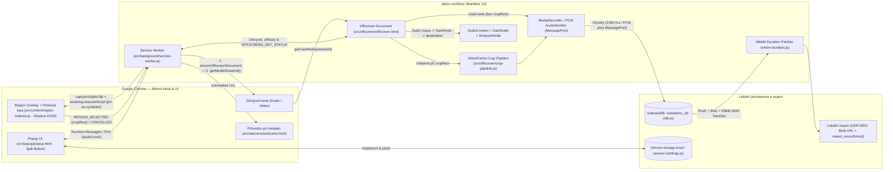
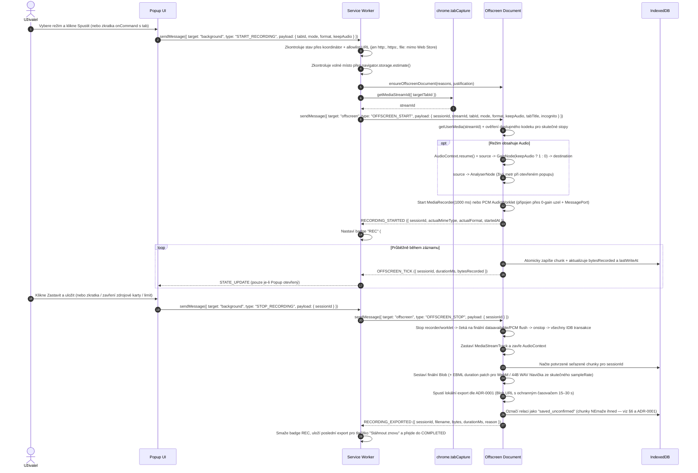

# WebTabRec — Technická specifikace architektury (SSOT)

> **Nadřazený přehled (Vrstva 1):** [Koncepce a architektura](../concept-and-architecture.md)  
> **Architektonická rozhodnutí:** [ADR-0001: Lokální handoff stažení](../adr/0001-local-download-handoff.md) · [ADR-0002: Výřez stránky a pixelová lupa](../adr/0002-region-video-capture.md) · [ADR-0003: WebCodecs MP4](../adr/0003-webcodecs-mp4-encoder.md) · [ADR-0004: Lokální MP3 enkodér](../adr/0004-local-mp3-audio-encoder.md)  
> **Stav:** Revize v1.4 — doplněn čistý JS MP3 enkodér v Offscreen Web Workeru (ADR-0004) a časová kontrola expirace `SELECTING_REGION` po uspání Service Workeru · **Licence:** MIT · **Cílová platforma:** Google Chrome 116+ *(přednostně ověřit na Chrome 116 a aktuálním Chrome Stable)*

---

## 1. Architektonická topologie (Manifest V3)

Rozšíření je rozděleno do šesti striktně oddělených lokálních kontextů bez externích síťových závislostí. **Důležité omezení MV3:** Offscreen dokument má z `chrome.*` k dispozici pouze `chrome.runtime` (nikoli `chrome.storage`, `chrome.i18n` ani `chrome.action`), proto sdílené moduly musí striktně oddělovat `idb.js` (čistá Web API) a `settings.js` (`chrome.storage.*`, pouze SW/Popup/Welcome).



---

## 2. Sekvence nahrávání a bezpečného exportu (End-to-End)

Pořadí při startu odpovídá oficiálnímu vzoru Chrome: **nejprve** připravit Offscreen dokument, **teprve poté** vyžádat krátkodobé `streamId` a ihned jej spotřebovat (aby při studeném startu nevypršelo).



---

## 3. Cílový kontrakt `manifest.json`

```json
{
  "manifest_version": 3,
  "name": "__MSG_extName__",
  "short_name": "WebTabRec",
  "description": "__MSG_extDescription__",
  "version": "1.0.0",
  "default_locale": "en",
  "minimum_chrome_version": "116",
  "homepage_url": "https://github.com/zocek/WebTabRec",
  "incognito": "not_allowed",
  "permissions": [
    "tabCapture",
    "offscreen",
    "activeTab",
    "storage",
    "scripting"
  ],
  "background": {
    "service_worker": "src/background/service-worker.js",
    "type": "module"
  },
  "action": {
    "default_popup": "src/popup/popup.html",
    "default_title": "__MSG_actionTitle__",
    "default_icon": {
      "16": "assets/icons/icon-16.png",
      "32": "assets/icons/icon-32.png",
      "48": "assets/icons/icon-48.png",
      "128": "assets/icons/icon-128.png"
    }
  },
  "icons": {
    "16": "assets/icons/icon-16.png",
    "32": "assets/icons/icon-32.png",
    "48": "assets/icons/icon-48.png",
    "128": "assets/icons/icon-128.png"
  },
  "commands": {
    "toggle-recording": {
      "suggested_key": {
        "default": "Alt+Shift+R",
        "mac": "MacCtrl+Shift+R"
      },
      "description": "__MSG_cmdToggleRecording__"
    },
    "toggle-pause": {
      "suggested_key": {
        "default": "Alt+Shift+P",
        "mac": "MacCtrl+Shift+P"
      },
      "description": "__MSG_cmdTogglePause__"
    }
  }
}
```

> **Poznámka k `commands`:** Zkratky fungují v aktivním okně prohlížeče Chrome (nejsou OS-globální). Na macOS záměrně používáme `MacCtrl+Shift+R/P`, aby nekolidovaly s vestavěným tvrdým obnovením stránky `Command+Shift+R`. UI vždy čte skutečné přiřazení zkratek za běhu přes `chrome.commands.getAll()`.

### Zdůvodnění minimálních oprávnění (Least Privilege)
- `tabCapture` — získání `MediaStreamId` pro aktuálně aktivní kartu výhradně po explicitní akci uživatele.
- `offscreen` — vytvoření skrytého dokumentu (`chrome.offscreen.createDocument` vždy s povinným polem `justification`) pro DOM / Web Audio / `MediaRecorder` / `Blob` kontext.
  - Důvody (`reasons`): `["USER_MEDIA", "AUDIO_PLAYBACK", "BLOBS"]` při startu záznamu se zvukem; `["USER_MEDIA", "BLOBS"]` u režimu pouze Video; `["BLOBS"]` při samostatném exportu/obnově bez živého záznamu. Zavírání řídí aplikační stav koordinátora (nikdy nezavírat, pokud běží jiný záznam nebo aktivní Blob URL handoff).
- `activeTab` — přečtení titulku (pro název souboru), jednorázové ověření URL aktuální karty v paměti a dočasné oprávnění pro pořízení snímku viewportu (`captureVisibleTab`) při výběru výřezu bez širokých oprávnění `tabs` či `<all_urls>`.
- `storage` — lokální uložení preferencí (`chrome.storage.local`) a synchronizace aktivního stavu relace (`chrome.storage.session`).
- `scripting` *(schváleno v [ADR-0002](../adr/0002-region-video-capture.md))* — injektování izolovaného Shadow DOM překryvu (`src/content/region-selector.js`) výhradně na vyžádání uživatele pro volbu výřezu stránky s pixelovou lupou. Spolu s `activeTab` (bez `host_permissions`) nezobrazuje žádné varování při instalaci.
- **Záměrně nepoužíváme bez ADR:** `<all_urls>`, `host_permissions`, `tabs`, `webRequest`, `downloads` *(viz [ADR-0001](../adr/0001-local-download-handoff.md))*, statické `content_scripts`.

---

## 4. Režimy záznamu, vyjednávání kodeků a mediální kvalita

Rozhodující výběr kodeku probíhá **v Offscreen dokumentu** podle skutečně zachycených stop přes `MediaRecorder.isTypeSupported(mime)` a po startu se ověří reálný `recorder.mimeType`.

| Režim (`mode`) | `getUserMedia` omezení | Preferované formáty a fallback řetězec | Výchozí parametry |
|---|---|---|---|
| `audio` | `audio: tabConstraint, video: false` | **MP3 (výchozí, ADR-0004):** `AudioWorkletNode` (`pcm-worklet.js`) → ES-modulový Offscreen Web Worker (`mp3-worker.js` + `mp3-encoder.js` + `mp3-tables.js`) → nezávislé MPEG-1 Layer III rámce (`audio/mpeg`) do IndexedDB<br>**WebM (Opus):** `audio/webm;codecs=opus` → `audio/webm`<br>**WAV (nekomprimovaný):** přímé streamování 16-bit PCM přes `AudioWorkletNode` → IndexedDB + 44B RIFF/WAV hlavička při exportu | Audio: `192 kbps` stereo CBR (MP3, 100 % obnova po pádu) / `128 kbps` (Opus, nezávislé na `videoQuality`) / skutečný `audioContext.sampleRate` stereo 16-bit (WAV) |
| `video` | `audio: false, video: tabConstraint` | **WebM (výchozí):** `video/webm;codecs=vp9` → `video/webm;codecs=vp8` → `video/webm`<br>**MP4 (nativní WebCodecs H.264 / záloha MediaRecorder):** `avc1.640033` → `avc1.640032` → `avc1.64002a` → `avc1.640028` → `avc1.4d4028` → `avc1.42e01f` | Adaptivní datový tok podle skutečného rozlišení `W×H` (`(W·H / 1080p)^0.75`):<br>Standard: ref `5 Mbps` (`0.8–5 Mbps` při až `1920×1080`, 30 fps; pojistný strop `6 Mbps`)<br>High: ref `10 Mbps` (`1.5–18 Mbps`; celá karta až `2560×1440`, výřez až `3840×2160`, 30 fps) |
| `both` | `audio: tabConstraint, video: tabConstraint` | **WebM (výchozí):** `video/webm;codecs=vp9,opus` → `video/webm;codecs=vp8,opus` → `video/webm`<br>**MP4 (nativní WebCodecs H.264 + AAC-LC / záloha MediaRecorder):** H.264 (`avc1.640033`..`avc1.42e01f`) + `mp4a.40.2` | Adaptivní video bitrate + audio:<br>Standard: `0.8–5 Mbps` (`6 Mbps` pojistka) + `128 kbps` (`30 fps`)<br>High: `1.5–18 Mbps` + `192 kbps` (celá karta až `2560×1440`, výřez až `3840×2160`, `30 fps`) |

### Kritická technická pravidla mediální vrstvy
1. **Kontrakt `AudioWorklet` a limit formátu WAV:**
   - **Zákaz `decodeAudioData`:** Pro WAV nikdy nedekódujeme celou nahrávku do RAM.
   - `AudioWorkletNode` musí být v audio grafu připojen přes pomocný `GainNode(gain = 0)` do `audioContext.destination`, aby prohlížeč worklet skutečně zpracovával i při vypnutém poslechu.
   - Procesor posílá ohraničené 16-bit PCM bloky (~1 s) přes `MessagePort` do `offscreen.js`, který je ukládá do IndexedDB. Při `PAUSE` procesor přestane sbírat PCM, ale větev poslechu (`GainNode`) zůstává funkční. Ošetřuje se `processorerror` i selhání `audioContext.resume()` (`state !== "running"`).
   - **Strop formátu RIFF/WAV:** Klasická 44B RIFF hlavička má 32bitová pole velikosti (max ~4 GB, u některých přehrávačů se znaménkem ~2 GB ≈ 3,1 h při 48 kHz stereu). Proto před dosažením **1,95 GB** (`WAV_MAX_SAFE_BYTES`) Offscreen bezpečně záznam ukončí, uloží validní soubor ze skutečného počtu potvrzených vzorků a `audioContext.sampleRate`, a zobrazí informaci `errWavSizeLimit`.
2. **WebM Seekable Indexer & Duration Patch (`src/shared/webm-duration.js`):**
   - `makeWebmSeekable` projde streamovaný WebM z `MediaRecorder`u v omezeném posuvném okně (4 MiB) bez dekódování a bez kopírování datových bloků (`Blob.slice`), doplní známou velikost `Segment`u i všech `Cluster`ů, zapíše `SeekHead`, přesnou `Duration` v `Info` (respektující `TimestampScale`) a na konec vygeneruje tabulku `Cues` pro klíčové snímky video stopy (případně pro clustery audio stopy v režimu *Jen zvuk*), což zajistí okamžité přetáčení v Chrome, Windows Přehrávači médií i VLC.
   - Při již existujícím `SeekHead`/`Cues` nebo nerozpoznané struktuře provede bezpečný fallback na `patchWebmDuration` (který upraví `Duration` bez narušení offsetů nebo vrátí původní `Blob`).
3. **MP4 — WebCodecs enkodér (`src/offscreen/webcodecs-mp4-recorder.js` + `src/shared/mp4-muxer.js`, ADR-0003) a záloha `makeMp4Seekable`:**
   - Pro formát MP4 (`video` a `both`) ověří Offscreen dokument před startem reálné cílové rozměry (`captureDims` / `cropRect`) i parametry zvuku přes `VideoEncoder.isConfigSupported` / `AudioEncoder.isConfigSupported` a přednostně používá nativní **WebCodecs API (`VideoEncoder` H.264 High/Main až Level 5.1 `avc1.640033` s `bitrateMode: 'variable'`, `latencyMode: 'quality'`, klíčové snímky každé 2 s a zero-copy GPU `visibleRect` ořezem + `AudioEncoder` AAC-LC `mp4a.40.2`)**.
   - Zakódovaná data se streamují v ~512 KiB dávkách do IndexedDB. Při exportu (`STOP` i *Stáhnout znovu*) se tabulka vzorků ořízne na souvislý potvrzený prefix v IDB a `buildFaststartMp4` složí přes zero-copy `Blob.slice` standardní *faststart* MP4 (`ftyp + moov(stts/stss/stsc/stsz/stco|co64 + edts/elst + colr z decoderConfig / výchozí bt709 limited) + mdat`).
   - Pokud prohlížeč reálnou konfiguraci WebCodecs H.264/AAC nepodporuje, před založením relace se plynule přepne na zálohu `MediaRecorder` + `makeMp4Seekable` (`src/shared/mp4-seekable.js`), příp. fallback na WebM.
4. **Audio Passthrough a živý audio metr:**
   - Graf: `source → passthroughGain (1 nebo 0) → destination` a paralelně `source → analyserNode`.
   - Aby periodické zprávy nespamovaly Service Worker každou desetinu sekundy, `OFFSCREEN_TICK` chodí po `1000 ms`, zatímco hladký živý metr hlasitosti (`~10 Hz`) posílá Offscreen přes krátkodobý `chrome.runtime.Port` (`"popup-meter"`) **pouze po dobu, kdy je Popup otevřený**.
5. **Nahrávání výřezu stránky (`src/offscreen/crop-pipeline.js` · ADR-0002):**
   - Při volbě výřezu předá uživatel normalizované souřadnice `cropRect: { xRatio, yRatio, wRatio, hRatio, cssWidth, cssHeight, viewportWidth, viewportHeight, viewportAspect }` (bez závislosti na pevném `devicePixelRatio` nebo zoomu). Service Worker provádí whitelist sanitizaci numerických polí `cropRect`.
   - Offscreen dokument sladí `tabCapture` capture rozměry (`maxWidth`/`maxHeight` dle zvoleného presetu `standard` až `1920 × 1080` nebo `high` až `3840 × 2160`) s poměrem stran karty a v `computeCropGeometry` navíc promítá výřez do aktivní obsahové plochy uvnitř `videoFrame.visibleRect` (odstranění případného pillarboxu či letterboxu Chromia).
   - Offscreen dokument zpracovává příchozí video stopu událostně (bez `requestAnimationFrame`, které Chrome ve skrytých dokumentech škrtí): `MediaStreamTrackProcessor` → asynchronní smyčka `reader`/`writer` v `src/offscreen/crop-pipeline.js` (jediný perzistentní `OffscreenCanvas` se sudými rozměry `outW = rawW & ~1`, `outH = rawH & ~1`, min. `32×32 px`) → `MediaStreamTrackGenerator`.
   - Každý snímek se ořízne vůči aktivní oblasti v `videoFrame.visibleRect` (s bezpečným ořezem `clamp` při změně velikosti okna), zachová původní `timestamp` a `duration` (přesná A/V synchronizace s původní audio stopou v režimu `both`) a v bloku `finally` **vždy zavolá `videoFrame.close()`** proti úniku GPU paměti.

---

## 5. Kontrakt zpráv (Message Protocol) a kanonické stavy

### 5.1 Kanonické stavy relace (`RECORDING_STATUS` v `src/shared/constants.js`)
- UI & Service Worker: `IDLE` | `SELECTING_REGION` | `STARTING` | `RECORDING` | `PAUSED` | `SAVING` | `COMPLETED` | `ERROR` | `RECOVERY`
- IndexedDB `sessions.status`: `active` | `interrupted` | `saved_unconfirmed` | `discarded`

### 5.2 Protokol zpráv
Každá zpráva má tvar `{ target: "background" | "offscreen" | "popup" | "content", type: string, payload?: object }`. Asynchronní posluchače `chrome.runtime.onMessage` v Chrome 116+ vždy vracejí doslovné `return true` a odpovídají přes `sendResponse`. Každý změnový příkaz i potvrzení nese `sessionId`.

| Typ zprávy | Směr | Význam a payload |
|---|---|---|
| `GET_STATE` | Popup → SW | Vrací kompletní stav (`status`, `sessionId`, `mode`, `format`, `actualFormat`, `keepAudio`, `cropActive`, `recordedTabId`, `recordedTabTitle`, `startedAt`, `pausedMs`, `bytesRecorded`, `errorCode`, `lastExport`, `recoverableSession`). |
| `START_REGION_SELECTION` | Popup → SW | Zahájí interaktivní výběr výřezu na kartě (`{ tabId, mode, format, videoQuality?, keepAudio, pickerMode?: "smart" \| "manual" }`). SW pořídí dočasný PNG snímek viewportu (`captureVisibleTab`), injektuje `region-selector.js` (včetně `pickerMode` a `showFirstUseHint`) a zavře popup. |
| `REGION_SELECTED` | Content Overlay → SW | Uživatel potvrdil výřez po odstranění překryvu: `{ tabId, selectionToken, cropRect: { xRatio, yRatio, wRatio, hRatio, cssWidth, cssHeight, viewportWidth, viewportHeight, viewportAspect } }`. SW ověří `sender.tab.id`, `frameId === 0` a token, provede whitelist sanitizaci `cropRect` a spustí záznam s ořezem. |
| `REGION_CANCELLED` | Content Overlay / Popup → SW | Uživatel zrušil výběr (`Esc` / Zrušit / zavření či přepnutí karty / TTL) → návrat do `IDLE`, uvolnění dočasného snímku z paměti. |
| `REGION_HINT_DISMISSED` | Content Overlay → SW | Uživatel zavřel jednorázový coachmark chytrého výběru (`{ tabId, selectionToken }`). SW ověří původ a uloží `regionSmartHintSeen: true` do `chrome.storage.local`. |
| `REGION_PICKER_MODE_CHANGED` | Content Overlay → SW | Uživatel přepnul režim výběru `[ Bloky \| Ručně ]` (`{ tabId, selectionToken, pickerMode }`). SW ověří původ a uloží preferenci `regionPickerMode`. |
| `OFFSCREEN_GET_STATUS` | SW → Offscreen | Dotaz na pravdivý běžící stav Offscreen dokumentu po probuzení SW (`{ active, activeSessionId, state, pendingExportsCount, exportsInFlight }`). |
| `OFFSCREEN_IDLE` | Offscreen → SW | Offscreen dokončil cleanup po chybovém ukončení (`exportsInFlight === 0`) a lze ho bezpečně zavřít. |
| `START_RECORDING` | Popup / Command → SW | Spustí záznam konkrétní karty `{ tabId, mode, format, videoQuality?, keepAudio, cropRect? }`. |
| `PAUSE_RECORDING` | Popup / Command → SW → Offscreen | Pozastaví záznam `{ sessionId }`. |
| `RESUME_RECORDING` | Popup / Command → SW → Offscreen | Obnoví záznam `{ sessionId }`. |
| `SET_KEEP_AUDIO` | Popup → SW → Offscreen | Přepne `keepAudio` na `GainNode` (`{ sessionId, keepAudio }`). |
| `STOP_RECORDING` | Popup / Command → SW → Offscreen | Zastaví záznam `{ sessionId }`, dokončí zápis do IDB a spustí export. |
| `OFFSCREEN_START` | SW → Offscreen | Předá `{ sessionId, streamId, tabId, mode, format, videoQuality?, keepAudio, tabTitle, incognito, cropRect?, viewportAspect? }`. |
| `OFFSCREEN_STOP` | SW → Offscreen | Spustí korektní ukončení a flush `{ sessionId, reason }`. |
| `RECORDING_STARTED` | Offscreen → SW → Popup | Potvrzení startu (pro MediaRecorder i PCM Worklet): `{ sessionId, actualFormat, actualMimeType, startedAt }`. |
| `OFFSCREEN_TICK` | Offscreen → SW → Popup | Telemetrie `1 Hz`: `{ sessionId, durationMs, bytesRecorded }`. |
| `RECORDING_EXPORTED` | Offscreen → SW → Popup | Potvrzení zahájení exportu: `{ sessionId, filename, bytes, durationMs, reason }`. |
| `EXPORT_AGAIN` | Popup → SW → Offscreen | Opakovaný export relace ve stavu `saved_unconfirmed` (`{ sessionId }`). |
| `DISMISS_EXPORT` | Popup → SW → Offscreen | Uživatel potvrdil/zavřel export — smaže dočasná data z IndexedDB (`{ sessionId }`). |
| `RECOVER_SESSION` | Popup → SW → Offscreen | Pokus o best-effort obnovu a stažení přerušené relace (`{ sessionId }`). |
| `DISCARD_SESSION` | Popup → SW → Offscreen | Smaže přerušenou relaci z IndexedDB (`{ sessionId }`). |
| `RECORDING_ERROR` | Offscreen / SW → Popup | Strukturovaná chyba `{ sessionId?, errorCode, detail }`. |

### 5.3 Mapování `errorCode` → i18n klíč
| `errorCode` | i18n klíč (`_locales/*/messages.json`) |
|---|---|
| `UNSUPPORTED_TAB` | `errUnsupportedTab` |
| `INJECTION_FAILED` | `errInjectionFailed` |
| `NOT_INVOKED` | `errNotInvoked` |
| `TAB_ALREADY_CAPTURED` | `errTabAlreadyCaptured` |
| `CAPTURE_FAILED` | `errCaptureFailed` |
| `AUDIO_CONTEXT_FAILED` | `errAudioContextFailed` |
| `STORAGE_QUOTA_EXCEEDED` | `errQuotaExceeded` |
| `QUOTA_LOW_PRESTART` | `errQuotaLowPrestart` |
| `WAV_SIZE_LIMIT` | `errWavSizeLimit` |
| `WRITE_FAILED` | `errWriteFailed` |
| `SAVE_FAILED` | `errSaveFailed` |
| `RECOVERY_FAILED` | `errRecoveryFailed` |
| `OFFSCREEN_LOST` | `errOffscreenLost` |

---

## 6. Schéma IndexedDB (`src/shared/idb.js`), retence a obnova po pádu

- **Databáze:** `webtabrec_db` (verze `1`)
- **Object Store `sessions`** (keyPath: `sessionId`):
  - `sessionId` (UUID string)
  - `mode` (`"audio" | "video" | "both"`)
  - `format` (`"webm" | "mp4" | "wav"`)
  - `mimeType` (string)
  - `sampleRate` (number, pro WAV)
  - `channels` (number, pro WAV)
  - `tabTitle` (string)
  - `incognito` (boolean)
  - `startedAt` (epoch ms)
  - `lastWriteAt` (epoch ms — aktualizováno při každém potvrzeném chunku)
  - `endedAt` (epoch ms | null)
  - `durationMs` (number)
  - `bytesRecorded` (number)
  - `status` (`"active" | "interrupted" | "saved_unconfirmed" | "discarded"`)
  - `encoder` (volitelné: `"webcodecs" | "mediarecorder" | "wav"`)
  - `hasMp4Meta` (volitelné boolean; indikuje, že relace má uložený záznam `mp4_meta` v `chunks[seq=-1]`)
- **Object Store `chunks`** (keyPath: `["sessionId", "seq"]`):
  - `sessionId` (string)
  - `seq` (monotonický integer `0, 1, 2, ...` pro mediální bloky; sentinel `-1` pro oddělený záznam `kind: "mp4_meta"` s tabulkou vzorků WebCodecs MP4, který se nenačítá při `listSessions()`)
  - `data` (`Blob` pro MediaRecorder, WebCodecs `mdat` dávky i streamovaný 16-bit PCM WAV; objekt `mp4Meta` u `seq = -1`)
  - `size` (number, bytes)

### Pravidla bezpečné retence, paměti a obnovy
1. **Paměťový rozpočet při exportu:** Při sestavování výstupního `Blob` se bloky čtou přes IDB `openCursor` a předávají jako pole `Blob` (včetně 16-bit PCM chunků pro WAV a `mdat` dávek pro WebCodecs MP4) bez kopírování do jediného souhrnného `ArrayBuffer` v RAM. Fronta zápisů do IndexedDB je sekvenční a omezená (`maxPending`, `maxQueued` backlog cap); po první chybě zápisu či kvóty se přeruší další ukládání, aby zůstal zachován souvislý potvrzený prefix dat, a u WebCodecs MP4 se sample tabulka ořízne výhradně na potvrzené bajty.
2. **Bezpečný export a retence (ADR-0001):**
   - Ochranný časovač (`15 s`, u souborů >100 MB `30 s`) řídí **výhradně** `URL.revokeObjectURL(blobUrl)` a uvolnění nečinného Offscreen dokumentu (jen pokud `pendingExportsCount === 0`, `exportsInFlight === 0` a neběží žádný záznam).
   - Data v IndexedDB přejdou do `saved_unconfirmed` (u WebCodecs MP4 atomicky společně s uložením `mp4Meta` do `chunks[seq=-1]`) a zůstanou pro tlačítko **Stáhnout znovu** do chvíle, kdy uživatel potvrzení zavře, úspěšně spustí novou nahrávku nebo uplyne 24 hodin od `endedAt`/`lastWriteAt`. Při selhání zápisu metadat se `Stáhnout znovu` nenabízí (`canExportAgain: false`).
   - U anonymních karet (`incognito: true`) se lokální retence nepoužívá — dočasné bloky se smažou ihned po uvolnění/exportu a při probuzení po pádu (`reconcileIdbSessions`) jsou okamžitě vymazány bez zobrazení v `RECOVERY`.
3. **Poctivá best-effort obnova po pádu (Crash Recovery):**
   - Při startu Service Workeru se přes `OFFSCREEN_GET_STATUS` ověří, zda relace označená `active` skutečně běží. Pokud ne a `bytesRecorded > 0`, označí se `interrupted` a na ikoně se zobrazí nenápadný odznak `?` (do otevření popupu) — s výjimkou nedokončených nativních WebCodecs MP4 relací bez `mp4Meta`, které se při rekonciliaci čistě vymažou místo nabízení neproveditelné obnovy.
   - **Rozlišení dle kontejneru:** U `WAV` (raw PCM chunky) lze hlavičku vždy dopsat a zachráněný soubor je spolehlivě přehratelný. U `WebM` a záložního `MediaRecorder MP4` je obnova po tvrdém pádu prohlížeče **best-effort** (závisí na zapsané hlavičce a platných clusterech/fragmentech). Nativní **WebCodecs MP4** (`encoder: "webcodecs"`) vyžaduje řádné dokončení přes `stop()` a bez `mp4Meta` se nikdy tiše neexportuje jako surová data.
4. **Bezpečná expirace 24 h:** Expirace při startu Service Workeru maže **výhradně** relace se stavem `interrupted`, `saved_unconfirmed` nebo `discarded` starší než 24 hodin podle `lastWriteAt`/`endedAt` (a opuštěné `0 B` relace). **Nikdy** nesmaže běžící `active` relaci ani probíhající export.

---

## 7. Matice hraničních stavů a produktová rozhodnutí

| Scénář | Očekávané chování systému |
|---|---|
| Spuštění na nepovolené stránce (vše mimo `http:`, `https:`, `file:`, nebo `chromewebstore.google.com` / `chrome.google.com/webstore`) | Allowlist kontrola vrátí `UNSUPPORTED_TAB`. Dodatečně se zachytí i jakákoli runtime chyba z `getMediaStreamId`. |
| Karta je již nahrávána nebo sdílena jiným nástrojem | SW zachytí chybu `tabCapture` a vrátí `TAB_ALREADY_CAPTURED`. |
| Chyba při spuštění klávesovou zkratkou (zavřený popup) | SW uloží chybu do `storage.session`, nastaví odznak `!` (zůstává do otevření popupu) a zapíše lokalizovaný text chyby do `chrome.action.setTitle`. |
| Navigace na jinou URL v téže nahrávané kartě | Nahrávání plynule pokračuje v rámci stejné karty (standardní chování `tabCapture`); titulek souboru odpovídá kartě v okamžiku zahájení záznamu. |
| Zavření zdrojové karty během `RECORDING` i `PAUSED` | `MediaStreamTrack.onended` vyvolá řádné `OFFSCREEN_STOP` (`reason: "tab_closed"`), počká na flush chunků a spustí export. |
| Uspání Service Workeru v MV3 & 5s watchdog | Při probuzení i periodicky každých `5 s` (během `RECORDING`/`PAUSED`) se SW dotáže `OFFSCREEN_GET_STATUS` (`active`, `savingSessionId`, `exportsInFlight`). Pokud probíhá finalizace exportu, SW obnoví stav `SAVING` a vyloučí relaci z rekonciliace i mazání. |
| Nedostatek místa (`QuotaExceededError`) nebo nízká kvóta před startem | Před startem kontrola `navigator.storage.estimate()`. Při chybě zápisu za běhu zastaví záznam, pokusí se o best-effort export dosud potvrzených chunků, **nemaže data naslepo** (ponechá relaci jako `interrupted` pro opakování či vědomé zahození) a nahlásí `STORAGE_QUOTA_EXCEEDED`. |
| Anonymní režim (Incognito) | V `manifest.json` výslovně zakázáno (`"incognito": "not_allowed"`), aby se soukromé karty nikdy nezapisovaly do diskové `IndexedDB` běžného profilu. Jako obrana do hloubky zůstává v kódu okamžité mazání pro případné `incognito: true` relace. |
| První instalace rozšíření | `chrome.runtime.onInstalled` (`reason === "install"`) jednorázově otevře lokální `src/welcome/welcome.html`. |

---

## 8. Struktura repozitáře

```text
WebTabRec/
├── manifest.json                         # MV3 manifest (verze 1.0.0, 5 minimálních oprávnění)
├── package.json                          # Skripty pro testování, validaci a balení (type: "module")
├── LICENSE                               # MIT licence
├── README.md                             # Vrstva 1: Hlavní anglický přehled projektu (GitHub + AI)
├── README.cs.md                          # Vrstva 1: Český přehled projektu
├── AGENTS.md                             # Závazné projektové instrukce
├── CONTRIBUTING.md                       # Průvodce pro přispěvatele a překladatele
├── CODE_OF_CONDUCT.md                    # Kodex chování komunity
├── PRIVACY.md                            # Zásady ochrany osobních údajů (EN + CS, v1.0)
├── SECURITY.md                           # Zásady hlášení bezpečnostních chyb
├── CHANGELOG.md                          # Historie verzí (Keep a Changelog / SemVer)
├── .editorconfig
├── .gitignore
├── .gitattributes
├── .github/
│   ├── PULL_REQUEST_TEMPLATE.md
│   └── ISSUE_TEMPLATE/
│       ├── bug_report.md
│       └── feature_request.md
├── _locales/                             # Jediný zdroj překladů (SSOT, 119 kanonických klíčů)
│   ├── en/messages.json                  # Výchozí angličtina (fallback)
│   └── cs/messages.json                  # Plná česká lokalizace
├── assets/
│   └── icons/                            # Runtime ikony rozšíření (PNG součástí ZIPu, SVG zdroj)
│       ├── icon.svg
│       ├── icon-16.png
│       ├── icon-32.png
│       ├── icon-48.png
│       └── icon-128.png                  # 96×96 motiv + plných 16 px čistě průhledný okraj
├── store/
│   └── assets/                           # Grafika pro Chrome Web Store — 24-bit RGB PNG (NEBALÍ se do ZIPu!)
│       ├── small-promo-440x280.png       # 24-bit RGB bez alfa kanálu
│       ├── marquee-promo-1400x560.png    # 24-bit RGB bez alfa kanálu
│       ├── screenshot-01-modes-1280x800.png
│       ├── screenshot-02-recording-1280x800.png
│       ├── screenshot-03-privacy-local-1280x800.png
│       ├── screenshot-04-languages-shortcuts-1280x800.png
│       └── screenshot-05-region-loupe-1280x800.png
├── src/                                  # Zdrojový kód rozšíření (čistý ES Modules JS/HTML/CSS)
│   ├── shared/
│   │   ├── constants.js                  # SUPPORTED_LOCALES, RECORDING_STATUS, MIME priority, limity
│   │   ├── i18n.js                       # Překladová vrstva (auto + ruční jazyk + placeholdery + RTL)
│   │   ├── idb.js                        # Čistý IndexedDB wrapper (bezpečný i v Offscreenu)
│   │   ├── settings.js                   # Wrapper pro chrome.storage.* (pouze SW / Popup / Welcome)
│   │   ├── filename.js                   # Bezpečná sanitizace názvu souboru (Windows/macOS/Linux)
│   │   └── webm-duration.js              # Omezený čistě JS EBML patch délky WebM
│   ├── background/
│   │   └── service-worker.js             # Orchestrace tabCapture, scripting, offscreen, badge, commands
│   ├── content/
│   │   └── region-selector.js            # On-demand Shadow DOM overlay + 8× kruhová pixelová lupa
│   ├── offscreen/
│   │   ├── offscreen.html
│   │   ├── offscreen.js                  # MediaRecorder, AudioContext/GainNode, MessagePort, export
│   │   ├── crop-pipeline.js              # MediaStreamTrackProcessor/Generator ořez výřezu (VideoFrame)
│   │   └── pcm-worklet.js                # AudioWorkletProcessor pro streamovaný 16-bit PCM WAV
│   ├── popup/
│   │   ├── popup.html
│   │   ├── popup.css                     # Design tokeny (Light/Dark, ověřený WCAG 2.1 AA kontrast)
│   │   └── popup.js                      # Stavové UI, přepínač jazyka, recovery & repeat-download lišta
│   └── welcome/
│       ├── welcome.html                  # Lokální průvodce po 1. instalaci + zkratky + soukromí + DRM
│       ├── welcome.css
│       └── welcome.js
├── scripts/                              # Vývojové a release skripty
│   ├── validate-locales.mjs              # Kontrola klíčů, placeholderů a limitů délek
│   └── package-release.mjs               # Sestavení čistého produkčního ZIPu + kontrola IHDR PNG
├── tests/                                # Automatizovaná sada testů (Node.js test runner)
│   ├── unit/
│   │   ├── helpers/mock-idb.js           # Izolovaný in-memory IndexedDB mock pro unit testy
│   │   └── *.test.js                     # Jednotkové testy sdílených modulů, SW, Offscreen, UI a skriptů
│   └── e2e/
│       ├── helpers/                      # chrome-mock.js, chrome-mock.test.js, fixtures.js
│       ├── static-audit.test.js          # Statický audit MV3 oprávnění, izolace, sítě, PNG a ZIPu
│       └── tier*.test.js                 # E2E testy funkcí, hraničních stavů, kombinací a scénářů
└── docs/
    ├── adr/                              # Architektonická rozhodnutí (ADR)
    │   ├── 0000-template.md
    │   ├── 0001-local-download-handoff.md
    │   └── 0002-region-video-capture.md
    ├── assets/                           # 1920×1080 PNG infografiky (Vrstva 1)
    ├── concept-and-architecture.md
    ├── design-and-ux.md
    ├── chrome-smoke-test-checklist.md    # Ruční Chrome 116+ smoke-test & Release Gate checklist
    ├── chrome-web-store-publishing.md
    ├── store-listing.md
    └── specs/                            # Vrstva 2 (SSOT)
        ├── architecture.spec.md
        ├── design-ui.spec.md
        ├── publishing.spec.md
        └── store-discoverability.spec.md
```
