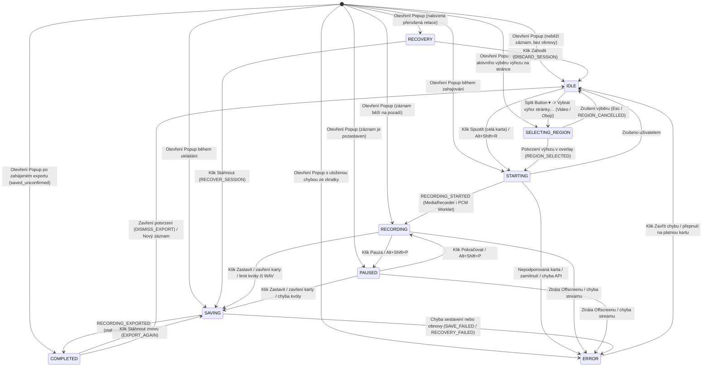
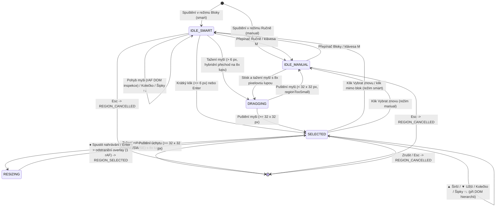

# WebTabRec — Technická specifikace UI, UX a lokalizace (SSOT)

> **Nadřazený přehled (Vrstva 1):** [Design, UX a lokalizace](../design-and-ux.md)  
> **Související ADR:** [ADR-0002: Výřez stránky a pixelová lupa](../adr/0002-region-video-capture.md) · [ADR-0004: Lokální MP3 enkodér](../adr/0004-local-mp3-audio-encoder.md)  
> **Stav:** Revize v1.5 — kompaktní hlavní panel (~290 px) bez nadbytečné karty aktivní karty v `IDLE`, vestavěný pohled *Výchozí nastavení* s `.info-callout` boxy, kompaktní přepínač jazyka (inline SVG vlajky + `popover="auto"`), tlačítko reproduktoru s WCAG 1.4.13 tooltipem a podpora `MP3` pro čisté audio · **Podporované jazyky v1.0:** `en` (výchozí), `cs` (plná lokalizace)

---

## 1. Stavový automat uživatelského rozhraní

Popup se může otevřít v libovolném stavu relace — výchozí stav se vždy synchronizuje přes `GET_STATE` se Service Workerem. Najednou může běžet maximálně jedna nahrávka.



---

## 2. Ergonomie pro běžného uživatele (Zero-Friction UX)

### 2.1 První spuštění po instalaci (`src/welcome/welcome.html`)
Chrome po instalaci nové rozšíření skrývá pod ikonou puzzle. Aby běžný uživatel přesně věděl, co udělat:
- Při `chrome.runtime.onInstalled` (`reason === "install"`) se **jednorázově** otevře čistá lokální stránka `src/welcome/welcome.html` (0 externích síťových požadavků, automaticky v jazyce prohlížeče se sjednoceným vlajkovým přepínačem jazyka a pilulkou *100 % lokálně · Bez cloudu* v hlavičce).
- Stránka je přehledně členěna do dvou hlavních vizuálních sekcí:
  1. **Jak začít ve 3 krocích** (`welcomeSectionStart`) — 3 očíslované karty s ikonami a názvy tlačítek shodnými s Popup UI:
     - **Otevřete nebo připněte WebTabRec na lištu**
     - **Přejděte na běžnou webovou stránku a vyberte režim** (Audio, Video, Obojí + šipka pro chytrý blok / ruční výřez s 8× lupou)
     - **Klikněte na Spustit nahrávání a na konci na Zastavit a uložit**
  2. **Dvousloupcová informační sekce:**
     - **Klávesové zkratky** (`welcomeShortcutsTitle`) s úvodním vysvětlením a jasným dělením do dvou podsekcí:
       - *Aktuální nastavení* (`welcomeShortcutsCurrent`) — dynamicky načtené přes `chrome.commands.getAll()`, seřazené podle důležitosti (`toggle-recording`, `toggle-pause`, `_execute_action`), s lidským lokalizovaným popisem i pro `_execute_action` (`cmdOpenPopup`: *Otevřít okno WebTabRec*) a srozumitelným štítkem `Nenastaveno` / `Not set` (`shortcutNotSet`) místo pomlčky, pokud zkratka není přiřazena.
       - *Nastavení a úprava zkratek* (`welcomeShortcutsConfigure`) — stručný návod a kopírovatelná adresa `chrome://extensions/shortcuts` s potvrzením *Zkopírováno* (`btnCopied`).
     - **100 % lokálně a s respektem k soukromí** (`welcomePrivacyTitle`) — 3 přehledné odrážky hlavních záruk (`welcomePrivacyPointLocal`, `welcomePrivacyPointPerms`, `welcomePrivacyPointFormats`) a jediný klidný informační callout (`.info-callout`) s `welcomeDrmNote` (bez duplicitního varování o systémových stránkách).
- Stránka je kdykoli přístupná klávesnicí i myší přes tlačítko `?` (`btnHelp`) v patičce popupu.

### 2.2 Zjednodušení Popup UI, vestavěné Nastavení a matice Režim × Formát
- **Šířka a výška okna:** výchozí `384 px`, ultrakompaktní hlavní obrazovka v `IDLE` (~285–305 px, bezpečně bez svislého posuvníku) a vestavěný druhý pohled **← Výchozí nastavení** rozdělený do 2 karet (`role="tablist"`: **Video a Obojí** ~385 px / **Pouze Audio** ~275 px, rovněž zcela bez posuvníku; při otevření se automaticky předvybere karta odpovídající aktuálnímu režimu). Odstraněna nadbytečná karta „Aktivní karta“ ve stavu `IDLE`. Přepnutí Hlavní ↔ Nastavení používá směrovou CSS animaci přes `transform`/`opacity` (bezpečnou i při automatické změně výšky Chrome popup okna, vypnutou při `prefers-reduced-motion: reduce`) se správou fokusu (`settingsHeading` při otevření, návrat na spouštěč při `Esc` / *Zpět*).
- **Tmavý a světlý motiv bez FOUC:** `popup.html` i `welcome.html` obsahují `<meta name="color-scheme" content="light dark">` a `:root { color-scheme: light dark; scrollbar-color: ...; accent-color: var(--accent-primary); }` s `light-dark()` tokeny a `@media (prefers-color-scheme: light)` fallbackem pro Chrome 116–122.
- **Extensible výběr jazyka (inline SVG vlajky + Popover API):** Hlavička zobrazuje kompaktní pilulku s lokální inline SVG vlajkou (`CS`, `EN`) či glóbem (`Auto` / budoucí jazyky) spouštějící nativní `popover="auto"` menu (`role="menu"` + `role="menuitemradio"`, `lang="en"` / `lang="cs"`, progresivní CSS Anchor Positioning uvnitř `@supports (position-area: block-end)`).
- **Kompaktní přepínač poslechu & přehled konfigurace:** Pod kartami režimů leží jediný řádek `.quick-bar`: vlevo klikací shrnutí aktivní konfigurace (např. `MP3 · 192 kbps` nebo `MP4 · Vysoká kvalita`, otevře *Nastavení*), vpravo kompaktní tlačítko reproduktoru (`Poslech` / `Ztlumeno`, `aria-pressed`) s přístupným WCAG 1.4.13 tooltipem (`popover="hint"`, `role="tooltip"`, `aria-describedby`). V režimu `video` se reproduktor skryje.
- **Info Callout boxy (`.info-callout`):** Všechna doporučení u formátů a kvality v *Nastavení* jsou graficky oddělena tónovaným panelem se svislým akcentním pruhem `border-inline-start: 3px solid var(--accent-primary)` (připraveno pro RTL a Windows `forced-colors`).
- **Karta nahrávaná na pozadí:** Pokud uživatel přepne na jinou kartu během aktivního záznamu (`RECORDING` / `PAUSED`) a otevře popup, zobrazí se zřetelně název **nahrávané karty** (`labelRecordedTab`, `statusRecording` = `Nahrává se: $TITLE$`) a tlačítko **Přejít na kartu** (`btnGoToRecordedTab`, přes `chrome.tabs.update(recordedTabId, { active: true })` — nevyžaduje oprávnění `tabs`).
- **Matice povolených formátů podle režimu** *(nastavováno ve vestavěném pohledu Výchozí nastavení; ukládá se v `chrome.storage.local`)*:

| Režim (`mode`) | Výchozí formát | Povolené volby v UI | Chování při nepodporovaném formátu |
|---|---|---|---|
| `audio` | `mp3` | `MP3 (Univerzální · 192 kbps)`, `WebM (Opus · nejmenší soubor)`, `WAV (Nekomprimovaný zvuk)` | Všechny 3 volby jsou vždy lokálně dostupné; obnova po pádu funguje pro MP3, WebM i WAV. |
| `video` | `webm` | `MP4 (H.264)` *(dle WebCodecs / `isTypeSupported`)*, `WebM (VP9 · obnova po pádu)` | Pokud prohlížeč MP4 nepodporuje, volba je deaktivovaná s popiskem `formatMp4Unsupported` a fallbackem na `webm`. |
| `both` | `webm` | `MP4 (H.264)` *(sdílená volba Video a Obojí)*, `WebM (VP9 · obnova po pádu)` | Stejné pravidlo jako u `video`; při startu z jiného kontextu (zkratka) ověří podporu Offscreen a případný fallback nahlásí. |

- **Bezpečné potvrzení exportu (`COMPLETED`):** Po `RECORDING_EXPORTED` se zobrazí *„Stahování zahájeno: $FILENAME$“* s tlačítky **Stáhnout znovu** (`btnDownloadAgain`) a **Hotovo** (`btnDismissExport`), aby uživatel nikdy nepřišel o nahrávku při zrušeném dialogu *Uložit jako*.

### 2.3 Split Button, Smart Block Picker & Ruční výběr výřezu s pixelovou lupou (ADR-0002)

Aby základní popup zůstal maximálně čistý a nepřibývala nová tlačítka ani čtvrtý režim, je výběr výřezu dostupný jako **rozšiřující šipka přímo u hlavního tlačítka nahrávání** (`Split Button`):

1. **Chování tlačítka podle zvoleného režimu:**
   - **Režim `Audio`:** Jednoduché jednodílné tlačítko `● Spustit nahrávání`.
   - **Režimy `Video` a `Obojí`:** Dvojdílný **Split Button** `[ ● Spustit nahrávání  |  ▾ ]` (oddělený jemnou svislou linkou):
     - Klik na levou hlavní část okamžitě spustí nahrávání **celé karty** (výchozí chování na 1 klik zůstává nedotčené).
     - Klik na pravou šipku `▾` (`aria-haspopup="menu"`, `aria-expanded`) rozbalí kompaktní nabídku se **3 položkami**:
       1. **Celá karta** (`menuRecordFullTab`, výchozí) — spustí záznam celé viditelné plochy karty.
       2. **Vybrat blok stránky (automaticky)…** (`menuRecordSmartRegion`) — zavře popup a spustí overlay v režimu `smart` (chytré označování logických DOM bloků).
       3. **Vybrat výřez ručně (lupa)…** (`menuRecordRegion`) — zavře popup a spustí overlay v režimu `manual` (ruční tažení s 8× pixelovou lupou).

2. **Horní plovoucí lišta v overlay (`src/content/region-selector.js` · closed Shadow DOM):**
   - Přepínač režimu **`[ Bloky | Ručně ]`** (`role="radiogroup"`, klávesová zkratka `M` v klidovém stavu) — volba se ukládá přes `REGION_PICKER_MODE_CHANGED` do `settings.regionPickerMode`.
   - Kontextová jednořádková nápověda (`regionHintSmart` / `regionHintDrag`).
   - Tlačítko **`?`** (zobrazené v režimu *Bloky*) pro kdykoli dostupné zobrazení / skrytí 3krokové karty tipů (*Coachmark*). Při úplně prvním použití režimu *Bloky* (`!settings.regionSmartHintSeen`) se neblokující coachmark otevře automaticky a trvale se skryje (`REGION_HINT_DISMISSED`) po kliknutí na **Rozumím** nebo při prvním kroku kolečkem/kliknutím/tažením.

3. **Stavový automat overlay výběru oblasti:**



4. **Algoritmus chytrého zásobníku kandidátů (Smart Block Picker):**
   - **Sestavení řetězce (`collectDeepElementsAtPoint`):** Dočasně nastaví `host.style.setProperty('pointer-events', 'none', 'important')`, zavolá `elementsFromPoint(x, y)` (se sestupem do otevřeného Shadow DOM až do hloubky `8`) a vychází výhradně z řetězce předků horního zasaženého prvku `hits[0]` (nikdy nemíchá nepříbuzné zakryté prvky pod modaly/cookie lištami). Jediná cílená výjimka: pokud je `hits[0]` nemediální průhledný overlay se shodným obdélníkem (±`4 px`) nad podkladovým `<video>`, `<iframe>` nebo `<canvas>`, převezme se řetězec od tohoto mediálního prvku.
   - **Ořez a filtrace (`buildSmartCandidateStack`):** Nejdříve od nejvnějšího předka ořízne potomky přes ořezávající předky (`overflow`/`overflowX`/`overflowY` ∈ `{hidden, clip, scroll, auto}`) i viewport (s respektem k `position: fixed`). Vyřadí skryté prvky (`display: none`, `visibility: hidden/collapse`, `opacity: 0`), prvky menší než `32 × 32 px`, prvky pokrývající `≥ 98 %` viewportu (s fallbackem, pokud nic jiného nezbude) a deduplikuje obalové `<div>` se shodným obdélníkem v toleranci `±4 px` (při sloučení vyhrává sémantičtější priorita).
   - **Výchozí úroveň (`pickDefaultCandidateIndex`):** Priorita 1 (`<video>`, `<iframe>`, `<canvas>`, ``/`<picture>`/`<figure>`/`<svg>`, `<table>`/`role=grid`, `<pre>`/`<code>`) → Priorita 2 (`<article>`, `<section>`, `<main>`, `<aside>`, `<dialog>`, `<nav>`, `<header>`, `<footer>` nebo vizuálně oddělená karta s pozadím/stínem/rámečkem/zaoblením) → nejvnitřnější platný prvek.
   - **Štítek a krokování:** Nad rámečkem zobrazuje typ prvku, rozměry a pozici v hierarchii (např. `Video · 854 × 480 px · 2/5`). Kolečko myši normalizuje `deltaMode` (pixel / řádek / stránka), vyžaduje práh `30 px` a v totožném směru aplikuje `120 ms` cooldown proti setrvačnosti trackpadu (změna směru reaguje okamžitě). Po uzamčení (`SELECTED`) se v akční liště zobrazují dotykově/trackpadově přívětivá tlačítka **`▲ Širší`** a **`▼ Užší`** a zobrazí se 4 rohové úchyty pro doladění na pixel s 8× lupou.

5. **Matice klávesových zkratek v overlay:**

| Klávesa | Fáze `IDLE` (*Bloky*) | Fáze `SELECTED` (s aktivní DOM hierarchií) | Fáze `SELECTED` (ruční / bez hierarchie) |
|---|---|---|---|
| `Kolečko nahoru` / `dolů` | Rozšířit na rodiče / zúžit na potomka | Rozšířit na rodiče / zúžit na potomka | — |
| `↑` / `↓`, `PageUp` / `PageDown`, `[` / `]`, `+` / `-` | Rozšířit / zúžit v hierarchii *(blokuje scroll stránky)* | Rozšířit / zúžit v hierarchii *(bez modifikátorů)* | `↑`/`↓` posun obdélníku o `1 px` |
| `←` / `→` *(nebo `Shift` + šipky)* | — | Posun o `1 px` (`Shift`: `10 px`, zruší hierarchii) | Posun o `1 px` (`Shift`: `10 px`) |
| `Ctrl`/`Alt` + šipky | — | Změna šířky/výšky o `1 px` (`Shift`: `10 px`) | Změna šířky/výšky o `1 px` (`Shift`: `10 px`) |
| `M` | Přepnout režim *Bloky ↔ Ručně* | — | — |
| `Enter` | Uzamknout zvýrazněný blok *(pokud není fokus na ovládacím tlačítku)* | Spustit nahrávání *(pokud není fokus na jiném tlačítku)* | Spustit nahrávání *(pokud není fokus na jiném tlačítku)* |
| `Esc` | Zrušit výběr (`REGION_CANCELLED`) | Zrušit výběr (`REGION_CANCELLED`) | Zrušit výběr (`REGION_CANCELLED`) |

6. **Ruční režim s kruhovou 8× pixelovou lupou & potvrzení:**
   - Kruhový zvětšovací průzor o průměru `136 px` (`2 px solid #38BDF8`) vykresluje **8× zvětšený výřez** (`imageSmoothingEnabled = false`) s 1px mřížkou, středovým zaměřovačem a souřadnicemi `X, Y` (při tažení i `W × H px`), s automatickým překlopením u okrajů viewportu.
   - Při stisku **`● Spustit nahrávání`** *(nebo `Enter`)* se overlay odstraní, vyčká 1 animační snímek (`requestAnimationFrame`) a odešle validovaný `cropRect` (`REGION_SELECTED`). Minimální velikost výřezu je `32 × 32 px`; výstupní rozměry kodéru se zaokrouhlují na sudé pixely. Při změně velikosti okna (`resize`) se stará cache DOM kandidátů bezpečně zneplatní.

---

## 3. Design tokeny a ověřený kontrast WCAG 2.1 AA

Všechny níže uvedené dvojice pozadí a popředí splňují minimální kontrastní poměr **≥ 4.5:1** pro běžný text i interaktivní prvky:

| Token | Tmavý režim (výchozí) | Světlý režim | Spárovaný text / kontrast | Použití |
|---|---|---|---|---|
| `--bg-canvas` | `#0F172A` | `#F8FAFC` | `--text-primary` (> 15:1) | Pozadí popupu a Welcome stránky |
| `--bg-surface` | `#1E293B` | `#FFFFFF` | `--text-primary` (> 11:1) | Karty nastavení, ovládací sekce |
| `--border-subtle` | `#6E8098` | `#64748B` | ≥ 3:1 proti pozadí (WCAG Non-Text: 3.63:1 dark / 4.55:1 light) | Ohraničení karet a ovládacích prvků |
| `--text-primary` | `#F8FAFC` | `#0F172A` | — | Hlavní nadpisy, časovač, štítky |
| `--text-secondary` | `#CBD5E1` | `#475569` | > 7:1 | Sekundární popisky, nápovědy |
| `--accent-primary` | `#38BDF8` *(text `#0F172A`)* | `#0369A1` *(text `#FFFFFF`)* | `9.8:1` (dark) / `5.93:1` (light) | Aktivní volba režimu, fokus, odkazy |
| `--accent-record` | `#DC2626` *(text `#FFFFFF`)* | `#B91C1C` *(text `#FFFFFF`)* | `4.83:1` (dark) / `6.47:1` (light) | Tlačítko Spustit nahrávání, REC odznak |
| `--accent-success` | `#10B981` *(text `#0F172A`)* | `#047857` *(text `#FFFFFF`)* | `8.9:1` (dark) / `5.48:1` (light) | Passthrough ON, lokální bezpečí, hotovo |
| `--accent-warning` | `#F59E0B` *(text `#0F172A`)* | `#B45309` *(text `#FFFFFF`)* | `9.7:1` (dark) / `5.02:1` (light) | Pauza, obnova po pádu, varování |
| `--radius-card` | `12px` | `12px` | — | Vnitřní sekce |
| `--radius-btn` | `10px` | `10px` | — | Tlačítka a přepínače |

### Stavový odznak na ikoně rozšíření (`chrome.action.setBadgeText`)

| Stav | Text odznaku | Barva pozadí | Barva textu (`setBadgeTextColor`) | Poznámka |
|---|---|---|---|---|
| `IDLE` / `COMPLETED` | `""` | — | — | Čistá ikona |
| `RECORDING` | `"REC"` | `#DC2626` | `#FFFFFF` | Aktivní záznam |
| `PAUSED` | `"II"` | `#F59E0B` | `#0F172A` | Pozastaveno |
| `RECOVERY` | `"?"` | `#B45309` | `#FFFFFF` | Čeká nedokončená nahrávka k obnově |
| `ERROR` | `"!"` | `#B91C1C` | `#FFFFFF` | Zůstává do otevření popupu + detail v `setTitle` |

---

## 4. Architektura internacionalizace (i18n)

1. **Nativní Chrome i18n (`_locales/<kod>/messages.json`):**
   - Manifest (`name`, `description`, `commands`) používá `__MSG_klíč__`, `default_locale: "en"`.
   - Jazyk karty v Chrome Web Store a popisu zkratek v `chrome://extensions/shortcuts` se řídí jazykem prohlížeče Chrome (omezení platformy Chrome).
2. **Runtime přepínač v Popup & Welcome UI (`src/shared/i18n.js`):**
   - Načítá lokální slovník z balíčku přes `fetch(chrome.runtime.getURL("_locales/<lang>/messages.json"))` (lokální `chrome-extension://` čtení, 0 externího síťového provozu).
   - **Normalizační řetězec v režimu `auto`:** `chrome.i18n.getUILanguage()` (např. `pt-BR`) zkouší v pořadí: plný tvar s podtržítkem (`pt_BR`) → 2písmenný základ (`pt`) → výchozí fallback (`en`).
   - **Směr textu (RTL připravenost):** Pokud budoucí jazyk vyžaduje RTL, `document.documentElement.dir` se nastavuje podle klíče `@@bidi_dir` / metadat jazyka.
   - **Formát placeholderů:** Používá standardní schéma Chrome `messages.json` s objektem `placeholders` (např. `$FILENAME$` → `"$1"`, `$TITLE$` → `"$1"`) a escapováním literálního znaku `$$` → `$`.

```json
{
  "statusDownloadStarted": {
    "message": "Download started: $FILENAME$",
    "placeholders": {
      "filename": {
        "content": "$1",
        "example": "webtabrec_lecture_2026-11-25_14-30-00.webm"
      }
    }
  }
}
```

### Registr podporovaných jazyků (`SUPPORTED_LOCALES` v `src/shared/constants.js`)

```json
{
  "SUPPORTED_LOCALES": [
    { "code": "auto", "labelKey": "languageAuto" },
    { "code": "en", "nativeName": "English" },
    { "code": "cs", "nativeName": "Čeština" }
  ]
}
```

> Položka `auto` používá lokalizační klíč `languageAuto` (nikoli natvrdo zapsaný řetězec), takže splňuje pravidlo nulových hardcoded textů z `AGENTS.md`.

---

## 5. Kanonický slovník klíčů (`_locales/*/messages.json`)

> **Poznámka k limitům:** Technický limit Chrome Web Store pro `extName` je **75 znaků** (projektový cíl čitelnosti je **≤ 45 znaků**), pro `extDescription` je **132 znaků**. V české verzi UI používáme jednotně termín **„karta“** (dle českého Chrome, kde „záložka“ označuje bookmark). Celkový počet kanonických klíčů je **157** (včetně MP3 audia, vestavěného pohledu *Výchozí nastavení*, kompaktního přepínače jazyka i poslechu, přepracované Welcome stránky, chytrého výběru bloků stránky a adaptivní kvality videa).

| Klíč | Angličtina (`en`) | Čeština (`cs`) |
|---|---|---|
| `extName` | `WebTabRec — Tab Audio & Video Recorder` | `WebTabRec — Nahrávání zvuku a videa z karty` |
| `extDescription` | `Free, open-source recorder for capturing audio, video, or both from a single tab 100% locally. No cloud, no time limits.` | `Bezplatný open-source nástroj pro lokální nahrávání zvuku, videa nebo obojího z jedné karty. Bez cloudu a časových limitů.` |
| `fallbackTabTitle` | `tab` | `karta` |
| `actionTitle` | `Open WebTabRec` | `Otevřít WebTabRec` |
| `actionTitleRecording` | `WebTabRec — Recording: $TITLE$` | `WebTabRec — Nahrává se: $TITLE$` |
| `actionTitlePaused` | `WebTabRec — Paused: $TITLE$` | `WebTabRec — Pozastaveno: $TITLE$` |
| `cmdToggleRecording` | `Start or stop tab recording` | `Spustit nebo zastavit nahrávání karty` |
| `cmdTogglePause` | `Pause or resume tab recording` | `Pozastavit nebo obnovit nahrávání karty` |
| `languageAuto` | `Auto (Browser language)` | `Automaticky (jazyk prohlížeče)` |
| `labelActiveTab` | `Active tab` | `Aktivní karta` |
| `labelRecordedTab` | `Recorded tab` | `Nahrávaná karta` |
| `btnGoToRecordedTab` | `Go to tab` | `Přejít na kartu` |
| `labelMode` | `What to record` | `Co chcete nahrát` |
| `modeAudio` | `Audio` | `Audio` |
| `modeAudioSub` | `Sound only` | `Pouze zvuk` |
| `modeVideo` | `Video` | `Video` |
| `modeVideoSub` | `Picture only` | `Pouze obraz` |
| `modeBoth` | `Both` | `Obojí` |
| `modeBothSub` | `Video + Audio` | `Obraz + zvuk` |
| `labelFormat` | `File format` | `Formát souboru` |
| `formatWebmRecommended` | `WebM (Recommended)` | `WebM (Doporučeno)` |
| `formatMp4` | `MP4 (H.264)` | `MP4 (H.264)` |
| `formatMp4Unsupported` | `MP4 (Not supported in this browser)` | `MP4 (Nepodporováno v tomto prohlížeči)` |
| `formatWav` | `WAV (Uncompressed audio)` | `WAV (Nekomprimovaný zvuk)` |
| `formatHintMp4` | `Best for video: smooth playback, accurate colors, and wide compatibility (Windows, Mac, mobile, editors). No crash recovery.` | `Doporučeno pro video: plynulý obraz, věrné barvy a široká kompatibilita (Windows, Mac, mobily, editory). Bez obnovy po pádu.` |
| `formatHintWebmVideo` | `Smaller files with crash recovery — great for long recordings and web playback. Choose MP4 for sharing or editing.` | `Menší soubor a obnova po pádu prohlížeče — vhodné pro dlouhé záznamy a web. Pro sdílení či střih zvolte MP4.` |
| `formatHintWebmAudio` | `Best for audio: crisp Opus sound in tiny files (~1 MB/min) with crash recovery.` | `Doporučeno pro zvuk: čistý zvuk Opus při malé velikosti (~1 MB/min) a obnova po pádu.` |
| `formatHintWav` | `Lossless audio for editing in audio tools — much larger files (~10 MB/min).` | `Bezztrátový zvuk pro další úpravy v audio editorech — výrazně větší soubor (~10 MB/min).` |
| `labelVideoQuality` | `Video quality` | `Kvalita videa` |
| `qualityStandard` | `Standard (smaller file)` | `Standardní (menší soubor)` |
| `qualityHigh` | `High (sharp details & colors)` | `Vysoká (ostré detaily a barvy)` |
| `qualityHintStandard` | `Balanced quality up to 1080p — bitrate adapts automatically to resolution for smaller files.` | `Vyvážená kvalita až 1080p — datový tok se automaticky přizpůsobí rozlišení pro menší soubory.` |
| `qualityHintHigh` | `Native resolution for sharp text and colors — bitrate adapts automatically to frame or region size.` | `Nativní rozlišení pro ostrý text a věrné barvy — datový tok se automaticky přizpůsobí velikosti obrazu či výřezu.` |
| `labelKeepAudio` | `Keep hearing tab audio` | `Slyšet zvuk během záznamu` |
| `btnMutePassthrough` | `Mute live playback` | `Ztlumit živý poslech` |
| `btnUnmutePassthrough` | `Unmute live playback` | `Obnovit živý poslech` |
| `labelLanguage` | `Language` | `Jazyk` |
| `labelDuration` | `Duration` | `Délka` |
| `labelSize` | `Size` | `Velikost` |
| `ariaAudioMeter` | `Live tab audio level` | `Živá úroveň zvuku karty` |
| `btnStart` | `Start Recording` | `Spustit nahrávání` |
| `btnStartMenuAria` | `More recording options` | `Další možnosti spuštění záznamu` |
| `menuRecordFullTab` | `Full tab` | `Celá karta` |
| `menuRecordSmartRegion` | `Select page block (auto)…` | `Vybrat blok stránky (automaticky)…` |
| `menuRecordSmartRegionSub` | `Hover to pick a block, scroll wheel to change level` | `Najetím označí prvek, kolečkem změní úroveň` |
| `menuRecordRegion` | `Select region manually (loupe)…` | `Vybrat výřez ručně (lupa)…` |
| `menuRecordRegionSub` | `Drag freely with the 8× pixel magnifier loupe` | `Přesný výběr tažením s 8× pixelovou lupou` |
| `regionModeSmart` | `Blocks` | `Bloky` |
| `regionModeManual` | `Manual` | `Ručně` |
| `regionHintSmart` | `Click to select block · Wheel / ↑↓: change level · Drag: manual · Esc: cancel` | `Klik: vybrat blok · Kolečko / ↑↓: změnit úroveň · Tažení: ručně · Esc: zrušit` |
| `regionHintDrag` | `Click and drag to select area · Press Esc to cancel` | `Klikněte a tažením vyberte výřez · Esc pro zrušení` |
| `regionHelpToggleAria` | `Show selection tips` | `Zobrazit nápovědu k výběru` |
| `regionCoachTitle` | `Quick tip: Smart block selection` | `Rychlý tip: Chytrý výběr bloků` |
| `regionCoachStepHover` | `Hover over any video, card, table, or section to highlight it automatically.` | `Najetím myší automaticky označíte video, kartu, tabulku nebo sekci.` |
| `regionCoachStepWheel` | `Scroll the mouse wheel or press ↑ / ↓ to expand or narrow the block level.` | `Kolečkem myši nebo šipkami ↑ / ↓ rozšíříte či zúžíte úroveň výběru.` |
| `regionCoachStepClick` | `Click to lock the block (or drag right away for manual selection with loupe).` | `Kliknutím blok zamknete (tažením rovnou přepnete na ruční výřez s lupou).` |
| `regionCoachGotIt` | `Got it` | `Rozumím` |
| `regionBtnWider` | `▲ Wider` | `▲ Širší` |
| `regionBtnNarrower` | `▼ Narrower` | `▼ Užší` |
| `regionBtnWiderTitle` | `Expand to parent block (PageUp or [)` | `Rozšířit na nadřazený blok (PageUp nebo [)` |
| `regionBtnNarrowerTitle` | `Narrow to inner block (PageDown or ])` | `Zúžit na vnořený blok (PageDown nebo ])` |
| `regionElVideo` | `Video` | `Video` |
| `regionElFrame` | `Frame` | `Rámec` |
| `regionElCanvas` | `Canvas` | `Plátno` |
| `regionElImage` | `Image` | `Obrázek` |
| `regionElTable` | `Table` | `Tabulka` |
| `regionElCode` | `Code` | `Kód` |
| `regionElDialog` | `Dialog` | `Dialog` |
| `regionElArticle` | `Article` | `Článek` |
| `regionElSection` | `Section` | `Sekce` |
| `regionElBlock` | `Block` | `Blok` |
| `regionBtnStart` | `Start Recording` | `Spustit nahrávání` |
| `regionBtnReselect` | `Reselect` | `Vybrat znovu` |
| `regionBtnCancel` | `Cancel` | `Zrušit` |
| `regionTooSmall` | `Selected area is too small (minimum 32 × 32 px). Drag a larger region.` | `Vybraný výřez je příliš malý (minimum 32 × 32 px). Zvolte větší oblast.` |
| `labelRegionActive` | `Page region ($SIZE$)` | `Výřez stránky ($SIZE$)` |
| `btnPause` | `Pause` | `Pauza` |
| `btnResume` | `Resume` | `Pokračovat` |
| `btnStopSave` | `Stop & Save` | `Zastavit a uložit` |
| `btnDownloadAgain` | `Download again` | `Stáhnout znovu` |
| `btnDismissExport` | `Done` | `Hotovo` |
| `btnCloseError` | `Dismiss` | `Zavřít` |
| `btnHelp` | `Quick guide & shortcuts` | `Rychlý návod a zkratky` |
| `footerPrivacy` | `100% Local · No Cloud` | `100 % lokálně · Bez cloudu` |
| `statusStarting` | `Starting recording...` | `Spouštění nahrávání...` |
| `statusRecording` | `Recording: $TITLE$` | `Nahrává se: $TITLE$` |
| `statusPaused` | `Paused: $TITLE$` | `Pozastaveno: $TITLE$` |
| `statusSaving` | `Preparing download...` | `Příprava souboru ke stažení...` |
| `statusDownloadStarted` | `Download started: $FILENAME$` | `Stahování zahájeno: $FILENAME$` |
| `statusTabClosedSaved` | `Recorded tab closed — download started automatically.` | `Nahrávaná karta byla zavřena — stahování se automaticky spustilo.` |
| `statusFormatFallback` | `Selected format was unavailable — recording in WebM.` | `Zvolený formát nebyl dostupný — nahrává se ve WebM.` |
| `recoveryTitle` | `Unfinished recording found` | `Nalezena nedokončená nahrávka` |
| `btnRecover` | `Download` | `Stáhnout` |
| `btnDiscard` | `Discard` | `Zahodit` |
| `errUnsupportedTab` | `Browser system pages (chrome:// or Web Store) cannot be recorded. Switch to a regular webpage and try again.` | `Systémové stránky prohlížeče (chrome:// nebo Web Store) nelze nahrávat. Přejděte na běžnou webovou stránku a zkuste to znovu.` |
| `errInjectionFailed` | `Cannot open the region selector on this page. Check extension permissions for local files or record the full tab.` | `Na této stránce nelze otevřít výběr výřezu. Zkontrolujte oprávnění pro místní soubory nebo nahrajte celou kartu.` |
| `errNotInvoked` | `Click the WebTabRec icon in the toolbar on this tab to allow recording.` | `Klikněte na ikonu WebTabRec na liště u této karty, aby bylo možné ji nahrávat.` |
| `errTabAlreadyCaptured` | `This tab is already being recorded or shared by another tool.` | `Tato karta už je nahrávána nebo sdílena jiným nástrojem.` |
| `errCaptureFailed` | `Could not start tab capture. Reload the tab and try again.` | `Nepodařilo se zahájit záznam karty. Obnovte stránku a zkuste to znovu.` |
| `errAudioContextFailed` | `Could not initialize local audio playback. Try clicking the page or reloading the tab.` | `Nepodařilo se spustit lokální přehrávání zvuku. Zkuste kliknout do stránky nebo kartu obnovit.` |
| `errQuotaExceeded` | `Browser storage is full. Recording was stopped and export was attempted.` | `Úložiště prohlížeče je plné. Záznam byl zastaven s pokusem o export.` |
| `errQuotaLowPrestart` | `Not enough free browser storage space to start recording. Free up space and try again.` | `V úložiště prohlížeče není dost volného místa pro spuštění záznamu. Uvolněte místo a zkuste to znovu.` |
| `errWavSizeLimit` | `WAV file size limit reached (~2 GB). Recording was safely stopped and prepared for download.` | `Byl dosažen technický limit velikosti WAV (~2 GB). Záznam byl bezpečně zastaven a připraven ke stažení.` |
| `errWriteFailed` | `Failed to save recording data to local browser storage. Reload the page or free up space and try again.` | `Nepodařilo se uložit data záznamu do místního úložiště prohlížeče. Obnovte stránku nebo uvolněte místo a zkuste to znovu.` |
| `errSaveFailed` | `Could not assemble or save the recording file. Dismiss this message and try recording again.` | `Nepodařilo se sestavit nebo uložit soubor nahrávky. Zavřete tuto hlášku a zkuste záznam spustit znovu.` |
| `errRecoveryFailed` | `The interrupted recording could not be recovered because the file structure was incomplete.` | `Přerušenou nahrávku se nepodařilo obnovit, protože struktura souboru nebyla kompletní.` |
| `errOffscreenLost` | `Background recorder stopped unexpectedly. Reopen the popup to check for recoverable data.` | `Nahrávání na pozadí bylo neočekávaně ukončeno. Znovu otevřete popup a zkontrolujte, zda jsou k dispozici data k obnovení.` |
| `btnCopyShortcuts` | `Copy shortcuts URL` | `Zkopírovat adresu zkratek` |
| `welcomeTitle` | `Welcome to WebTabRec` | `Vítejte ve WebTabRec` |
| `welcomeSubtitle` | `Record audio, video, or both from a single regular browser tab — 100% locally and free.` | `Nahrávejte zvuk, video nebo obojí z jedné běžné karty prohlížeče — 100 % lokálně a zdarma.` |
| `welcomeStep1Title` | `1. Open or pin WebTabRec on your toolbar` | `1. Otevřete nebo připněte WebTabRec na lištu` |
| `welcomeStep1Desc` | `Click the puzzle icon in the top-right corner to open WebTabRec anytime, or pin it for one-click access.` | `Klikněte na ikonu puzzle vpravo nahoře — můžete rozšíření spustit přímo, nebo si ho připnout špendlíkem.` |
| `welcomeStep2Title` | `2. Switch to a regular webpage and pick a mode` | `2. Přejděte na běžnou webovou stránku a vyberte režim` |
| `welcomeStep2Desc` | `Open the tab you want to record and choose Audio, Video, or Both.` | `Otevřete kartu, kterou chcete nahrát, a zvolte Audio, Video nebo Obojí.` |
| `welcomeStep3Title` | `3. Click Start Recording, then Stop & Save` | `3. Klikněte na Spustit nahrávání a na konci na Zastavit a uložit` |
| `welcomeStep3Desc` | `You can close the popup or switch tabs anytime. When finished, click Stop & Save to download your file locally.` | `Popup můžete zavřít nebo přepnout na jinou kartu. Po skončení klikněte na Zastavit a uložit a soubor se stáhne.` |
| `welcomeShortcutsTitle` | `Keyboard shortcuts (active Chrome window)` | `Klávesové zkratky (v aktivním okně Chrome)` |
| `welcomePrivacyTitle` | `100% Local & Privacy-First` | `100 % lokálně a s respektem k soukromí` |
| `welcomeDrmNote` | `Note: Browser system pages (chrome://) and strict DRM streaming sites cannot be recorded due to browser security restrictions.` | `Poznámka: Systémové stránky prohlížeče (chrome://) a přísně chráněný DRM obsah nelze z bezpečnostních důvodů prohlížeče nahrávat.` |

---

## 6. Přístupnost (Accessibility) a bezpečné názvy souborů

- **WCAG 2.1 AA:** Kontrast textu ≥ `4.5:1` a ovládacích prvků / okrajů ≥ `3:1` v tmavém i světlém motivu (viz tabulka tokenů §3).
- **Klávesnice a sémantika:** Preferovat nativní prvky (`<input type="radio">`, `<select>`, `<button>`) s viditelným `:focus-visible` obrysem a kompletním průchodem přes `Tab` / šipky.
- **Čtečky obrazovky:** `aria-live="polite"` používat **pouze** pro významné změny stavu (`statusRecording`, `statusDownloadStarted`, chyby). Časovač a živý audio metr musí zůstat **mimo** živou oblast, aby čtečku nepřehlušily každou sekundu. Respektovat `@media (prefers-reduced-motion: reduce)`.
- **Sanitizace názvu souboru (`src/shared/filename.js`):**
  - Formát: `webtabrec_<sanitizovany-titulek>_YYYY-MM-DD_HH-mm-ss.<ext>`, max délka titulku `48` znaků.
  - Odstranit znaky `\ / : * ? " < > |` i řídicí znaky (`0x00–0x1F`, `0x7F`), ořezat tečky a mezery na začátku i na konci.
  - Ošetřit rezervovaná jména Windows (`CON`, `PRN`, `AUX`, `NUL`, `COM1–COM9`, `LPT1–LPT9`) a prázdný titulek fallbackem `tab`. Ověřit jednotkovými testy.
