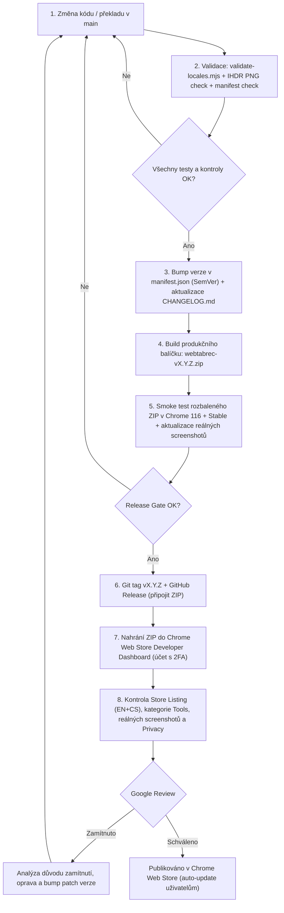
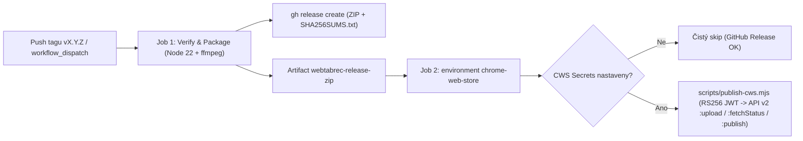

# WebTabRec — Technická specifikace publikace a vydávání (SSOT)

> **Nadřazený přehled (Vrstva 1):** [Publikace do Chrome Web Store a GitHub Release](../chrome-web-store-publishing.md)  
> **Související specifikace:** [Karta ve Store, SEO a AI dohledatelnost](store-discoverability.spec.md) · [ADR-0001](../adr/0001-local-download-handoff.md) · [ADR-0002](../adr/0002-region-video-capture.md)  
> **Stav:** Revize v1.3 — doplněno oprávnění `scripting` (ADR-0002) a 5. screenshot výřezu s lupou · **Distribuční kanály:** GitHub Releases (zdrojový kód + ZIP) & Chrome Web Store (zdarma)

---

## 1. Release a publikační pipeline

---

## 2. Zatřídění a grafické podklady pro Chrome Web Store

### 2.1 Oficiální zatřídění v Developer Dashboard
- **Primary Category:** **`Tools`** *(ve skupině Productivity)* — přesně odpovídá aktuální oficiální taxonomii Chrome Web Store.
- **Language:** Výchozí `English` + lokalizace `Czech` (z `_locales/cs/messages.json`).
- **Pricing & Distribution:** `Free` · `Public` · `All regions`.
- **Účet vývojáře:** Vyžaduje zapnuté **dvoufázové ověření (2FA)**, ověřený kontaktní e-mail a jednorázový registrační poplatek `$5 USD`.
- **Kompletní texty pro Store Listing (EN + CS):** viz [docs/store-listing.md](../store-listing.md) a [docs/specs/store-discoverability.spec.md](store-discoverability.spec.md).

### 2.2 Specifikace grafických podkladů
> [!IMPORTANT]
> Screenshoty v `store/assets/screenshot-01..05-1280x800.png` jsou **vygenerovány ze skutečně implementovaného UI verze `v1.0.0`** (24-bit RGB PNG bez alfa kanálu). Před finálním odesláním do Chrome Web Store lze dle potřeby volitelně pořídit ještě živé snímky přímo v okně Chrome a doplnit samostatnou CS lokalizovanou sadu.

Veškeré propagační podklady a screenshoty v `store/assets/` **musí být neprůhledné (24-bit RGB PNG ColorType=2 nebo JPEG bez alfa kanálu)**.

| Podklad | Umístění v repozitáři | Rozměr (px) | Barevný prostor | Povinnost | Technická poznámka |
|---|---|---|---|---|---|
| **Ikony v balíčku** | `assets/icons/icon-{16,32,48,128}.png` | `16`, `32`, `48`, `128` | 32-bit RGBA PNG | **Povinné** | `128×128`: motiv přísně uvnitř `96×96` + `16 px` plně průhledný okraj (`alpha = 0` mimo `16..111`). `icon.svg` je pouze zdroj, nebalí se do ZIPu. |
| **Screenshoty** | `store/assets/screenshot-01..05-1280x800.png` | `1280 × 800` | **24-bit RGB PNG (bez alfa)** | **Povinné** (1–5 ks) | 5 ks (max. limit CWS): Režimy + Split Button, Výřez stránky s pixelovou lupou, Živý záznam na pozadí, 100 % lokální soukromí, Jazyky & zkratky. Vygenerováno z implementovaného UI `v1.0.0`. |
| **Small Promo Tile** | `store/assets/small-promo-440x280.png` | `440 × 280` | **24-bit RGB PNG (bez alfa)** | **Silně doporučené** *(ověřit aktuální povinnost v Dashboardu)* | Zobrazuje se ve vyhledávání Store a kolekcích. |
| **Marquee Promo Tile** | `store/assets/marquee-promo-1400x560.png` | `1400 × 560` | **24-bit RGB PNG (bez alfa)** | Doporučené | Pro nominaci do doporučených kolekcí Google. |

---

## 3. Připravené podklady pro Chrome Developer Dashboard (Privacy & Review)

Chrome Web Store Review probíhá primárně v angličtině. Následující texty slouží jako přesný podklad pro sekci **Privacy practices**:

### Single Purpose Description
> WebTabRec has a single, clear purpose: recording audio, video, or both from the user's currently active browser tab locally on their device, with zero cloud uploads, accounts, or tracking.

### Permission Justifications

| Oprávnění | Text zdůvodnění pro Chrome Web Store Dashboard |
|---|---|
| `tabCapture` | Required exclusively to obtain a media stream ID for the currently active browser tab when the user explicitly starts a recording (via the popup button or keyboard shortcut). Used to record audio, video, or both from that single tab only. |
| `offscreen` | Required in Manifest V3 to host MediaRecorder, native WebCodecs H.264/AAC MP4 encoding, a local pure-JS MP3 Web Worker, AudioContext audio passthrough (so the tab remains audible during capture), optional PCM AudioWorklet WAV recording, and local Blob export in a dedicated offscreen document so recording continues reliably after the user closes the popup or switches tabs. |
| `activeTab` | Required strictly upon user invocation to read the active tab's title (for generating a readable local filename), verify in memory that the active URL is a recordable webpage, and capture a single transient viewport snapshot when the user chooses region selection — without requesting broad host permissions or the tabs permission. |
| `storage` | Required to store user preferences locally in chrome.storage.local (selected UI language, default recording mode, preferred format per mode, video quality preset, audio passthrough toggle, and region picker preference) and synchronize active recording session state in chrome.storage.session between the Service Worker and Popup UI. |
| `scripting` | Required exclusively on user demand (when selecting "Select page block (auto)…" or "Select region manually (loupe)…" in Video or Both mode) to inject an isolated closed Shadow DOM region-selection overlay with a pixel magnifier onto the active tab via activeTab, then remove it immediately before recording starts. Never injects scripts automatically or on background tabs. |

### Remote Code Declaration
- **Are you using remote code?** → **No, I am not using Remote code.** (Veškerý JavaScript, CSS, ikony i překlady jsou přibaleny přímo v ZIP archivu.)

### Reviewer Testing Instructions (doporučený text do pole *Testing instructions* v Developer Dashboard)
> 1. Open any regular webpage with playing audio or video (e.g., an online video, lecture, or podcast).
> 2. Click the WebTabRec toolbar icon and test **Audio** (exports locally as MP3 192 kbps by default; WebM and WAV are in Default Settings ⚙), **Video**, or **Both** (MP4 / WebM).
> 3. Optionally open the split-button arrow next to **Start Recording** in Video or Both mode to test on-demand Smart Block Selection or the manual 8× pixel loupe (`scripting` is injected strictly on explicit user click via `activeTab` and removed before capture begins).
> 4. Open Chrome DevTools → Network across Popup, Welcome, Offscreen Document, and Service Worker to confirm **0 external network requests**.

### Data Flow & Data Usage Disclosure Map (klíčové pro přesné vyplnění Dashboardu)
Místo paušálního „neexistují žádná uživatelská data“ je nutné rozlišit **lokální zpracování na zařízení** od **sběru a přenosu vývojářem** (dle aktuálního Google Chrome Web Store User Data FAQ):

| Datový prvek | Jak s ním WebTabRec nakládá | Opouští zařízení? | Retence |
|---|---|---|---|
| **Audio/Video stream karty** | Zpracováno výhradně lokálně v Offscreen dokumentu (`MediaRecorder`, `WebCodecs`, `AudioWorklet` + pure-JS MP3 Worker) a dočasně v `IndexedDB` pro lokální export uživateli. | **Ne (0 síťových volání)** | Do potvrzení/zavření exportu nebo max. 24 h (při startu SW); anonymní okna zakázána v manifestu (`"incognito": "not_allowed"`). |
| **Snímek viewportu pro pixelovou lupu** | Jednorázový snímek (`captureVisibleTab`) v paměti pouze po dobu výběru výřezu stránky (ADR-0002). | **Ne** | **Neukládá se** na disk; uvolněno ihned po potvrzení nebo zrušení výběru. |
| **Titulek karty (`tab.title`)** | Čteno po akci uživatele pro název staženého souboru a popis nahrávané karty v popupu. | **Ne** | Pouze po dobu existence relace v `storage.session` / `IndexedDB`. |
| **URL karty (`tab.url`)** | Jednorázová kontrola povoleného protokolu v paměti při startu. | **Ne** | **Neukládá se** nikam na disk. |
| **Uživatelské preference** | Jazyk, režim, formát pro každý režim, `videoQuality`, `keepAudio`, `regionPickerMode`, `regionSmartHintSeen` v `chrome.storage.local`. | **Ne** | Lokálně do odinstalace rozšíření. |

- **Postup při vyplňování sekce Data Usage v Dashboardu:**
  1. Před odesláním ověřit aktuální formulaci Google *User Data FAQ* ohledně toho, zda výhradně lokálně zpracovaný obsah karty bez přenosu vývojářem vyžaduje zaškrtnutí kategorie *Website content* (nebo nikoli), a sladit zaškrtnutí s touto mapou i oběma jazykovými verzemi [PRIVACY.md](../../PRIVACY.md).
  2. V sekci certifikací vždy potvrdit: data se **neprodávají třetím stranám**, **nepoužívají se k účelům mimo jediný účel rozšíření** a **nepoužívají se k hodnocení bonity/úvěrů**.
  3. **Privacy Policy URL:** Trvalá veřejná adresa (nejjednodušeji přímo veřejný `PRIVACY.md` v GitHub repozitáři nebo vygenerovaná stránka na GitHub Pages — nikdy Google Docs ani zkracovače URL).

---

## 4. Specifikace balení (`scripts/package-release.mjs`)

### Zahrnout do `webtabrec-vX.Y.Z.zip`
- `manifest.json` (bez `optional_permissions` a `optional_host_permissions`)
- `_locales/**`
- `assets/icons/icon-16.png`, `icon-32.png`, `icon-48.png`, `icon-128.png` *(zdrojové `icon.svg` se do ZIPu **nebalí**)*
- `src/**/*.{js,html,css}` *(přísný allowlist přípon — žádné `.map`, `.txt` ani `.md`)*
- `LICENSE`

### Striktně vyloučit z produkčního ZIPu
- `.git/`, `.github/`, `.gitignore`, `.gitattributes`, `.editorconfig`
- `docs/`, `store/`, `scripts/`, `tests/`
- `assets/icons/icon.svg`
- `AGENTS.md`, `CONTRIBUTING.md`, `CODE_OF_CONDUCT.md`, `README.md`, `README.cs.md`, `PRIVACY.md`, `SECURITY.md`, `CHANGELOG.md`
- `node_modules/`, `dist/`, `*.map`, `.DS_Store`, `Thumbs.db`

---

## 5. Kontrolní matice před každým vydáním (Release Gate)

> **Vykonatelný kontrolní seznam pro ruční testování v Chrome:** [docs/chrome-smoke-test-checklist.md](../chrome-smoke-test-checklist.md) (vyžaduje **Node.js ≥ 22** pro skripty a reálný prohlížeč **Chrome 116+ / Stable** pro ruční smoke test).

| Kontrola | Způsob ověření | Požadovaný výsledek |
|---|---|---|
| Validní `manifest.json` (MV3) | JSON parse + načtení v **Chrome 116** i aktuálním **Chrome Stable** | 0 chyb, 0 varování |
| Úplnost lokalizací (`en`, `cs`, …) | `node scripts/validate-locales.mjs` | 100 % shoda klíčů, validní placeholdery, `extName` ≤ 45 (limit CWS 75), `extDescription` ≤ 132 |
| První instalace (`welcome.html`) | Čistá instalace v novém profilu Chrome | Otevře lokálního průvodce (EN/CS), zobrazí aktuální zkratky, 0 externích volání |
| Režim Audio (WebM & WAV) | 30 s záznam + dlouhé ticho + přepnutí karty + živé ztlumení + poslech | Zvuk slyšitelný i přepínatelný; WebM i WAV přehratelné bez poškození |
| Režim Video | Animovaná stránka bez zvuku, přepínač poslechu skrytý | Plynulý obraz bez zvukové stopy |
| Výřez stránky + Pixelová lupa (ADR-0002) | Split Button `▾` → *Vybrat výřez stránky…* při 100 % i 125–150 % DPI, liché pixely, `Esc`, video i `Video + Audio` | Přesný ořez bez zašedlého overlay ve videu, hladký 8× pixel zoom, synchronizovaný zvuk, 0 `VideoFrame` leaků |
| Režim Video + Audio (WebM & MP4) | Pauza/pokračování + kontrola délky i přetáčení (VLC, Windows přehrávač, Chrome) | Synchronizovaný obraz i zvuk; doložená délka a přetáčení |
| Handoff stažení & opakovaný export (ADR-0001) | 2 po sobě jdoucí nahrávky × zapnuté/vypnuté *„Ptát se kam uložit“* × zrušený dialog + *Stáhnout znovu* | Žádná ztráta dat; funguje opakovaný export i po zavření zdrojové karty |
| Pád, restart SW a kvóta | Vynucené ukončení/uspání SW + simulace přerušené relace + simulace `QuotaExceededError` | SW obnoví pravdivý stav z Offscreenu; recovery lišta funguje nebo čistě ohlásí `RECOVERY_FAILED` |
| Nepodporované karty & zkratky | Klik i zkratka na `chrome://extensions`, `chromewebstore.google.com` | Čistá lokalizovaná hláška, odznak `!` + detail v tooltipu, bez pádu |
| Síťová čistota (všechny kontexty) | Chrome DevTools → Network u **Popup, Welcome, Offscreen i Service Workeru** | **0 externích HTTP požadavků** z kontextu rozšíření |
| Grafika pro Store (`store/assets/` & `assets/icons/`) | Automatická kontrola PNG IHDR, absence `tRNS` a plného dekódování `IDAT` v `package-release.mjs` + vizuální audit | Store PNG: přesné rozměry, **ColorType = 2 (24-bit RGB bez `tRNS`)**; `icon-128.png`: `alpha = 0` v 16px okraji; finální screenshoty z RC buildu |
| Čistota ZIPu | Výpis obsahu `webtabrec-vX.Y.Z.zip` | Pouze runtime soubory (bez `store/`, `docs/`, `icon.svg`), velikost < 1 MB |

---

## 6. Automatizovaný Release & Chrome Web Store API v2 (`.github/workflows/release.yml`)

- **Skript:** `scripts/publish-cws.mjs` (čistý Node.js bez externích balíčků; vyloučen z runtime ZIP balíčku přes denylist `scripts/`).
- **Endpointy Chrome Web Store API v2 (scope `https://www.googleapis.com/auth/chromewebstore`):**
  - Upload: `POST https://chromewebstore.googleapis.com/upload/v2/publishers/{PUBLISHER_ID}/items/{EXTENSION_ID}:upload` (`Content-Type: application/zip`)
  - Polling při `IN_PROGRESS`: `GET https://chromewebstore.googleapis.com/v2/publishers/{PUBLISHER_ID}/items/{EXTENSION_ID}:fetchStatus`
  - Odeslání (pro režimy `staged` = `STAGED_PUBLISH` a `publish` = `DEFAULT_PUBLISH`): `POST https://chromewebstore.googleapis.com/v2/publishers/{PUBLISHER_ID}/items/{EXTENSION_ID}:publish`
- **GitHub Secrets (doporučeno uložit do Environmentu `chrome-web-store` s ručním schválením):**
  - `CHROME_PUBLISHER_ID` — Publisher ID z Chrome Web Store Developer Dashboard (*Account*)
  - `CHROME_EXTENSION_ID` — 32znakové ID položky (`a–p`) přidělené po prvním ručním založení `v1.0.0`
  - `CHROME_SERVICE_ACCOUNT_JSON` — JSON klíč Google Cloud Service Accountu přidaného v Dashboardu pod *Account*

---

## 7. Verzování, schvalování a rollback (SemVer)

- Používáme **Semantic Versioning** (`MAJOR.MINOR.PATCH`), Chrome vyžaduje 1–4 celá čísla oddělená tečkou (`1.0.0`, `1.1.0`, `1.1.1`).
- Verze v `manifest.json` musí být při každém nahrání **striktně vyšší** než předchozí publikovaná verze.
- **Doba schvalování Google Review:** Obvykle 1–3 pracovní dny, ale při manuální kontrole může trvat i déle (v krajním případě 1–2 týdny) — neplánovat vydání „na minutu“.
- **Rollback při závažné chybě:**
  1. Nejprve využít vestavěnou funkci **Rollback** v Chrome Web Store Developer Dashboard (pokud je pro předchozí schválenou verzi dostupná — znovu vydá předchozí balíček s vyšším číslem verze bez čekání na plný build).
  2. Následně zarovnat `main` v Gitu (revert problémového commitu) a připravit řádný `PATCH` release s testem.
