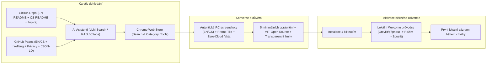

# WebTabRec — Specifikace karty ve Store, SEO a AI dohledatelnosti (SSOT)

> **Nadřazený přehled (Vrstva 1):** [Karta ve Store, texty a dohledatelnost](../store-listing.md)  
> **Související specifikace:** [Publikace a vydávání](publishing.spec.md) · [Design, UX a lokalizace](design-ui.spec.md)  
> **Stav:** Revize v1.2 — po nezávislé oponentuře (Claude + Codex)

---

## 1. Trychtýř dohledatelnosti (Člověk + AI asistenti → Instalace)



---

## 2. Limity a pravidla Chrome Web Store (Policy Compliance)

Google přísně odmítá **keyword stuffing** (seznamy klíčových slov na konci popisu), klamavé screenshoty a zneužití ochranných známek.

| Pole v Chrome Web Store | Technický limit platformy | Projektový cíl WebTabRec | Policy pravidla |
|---|---|---|---|
| **Název (`extName`)** | max `75 znaků` *(Chrome)* | **≤ 45 znaků** *(čitelnost v kartách)* | Nesmí obsahovat ochranné známky *„Google“* ani *„Chrome“* v názvu produktu. |
| **Krátký název (`short_name`)** | max `12 znaků` *(doporučeno)* | `WebTabRec` (9 znaků) | Pro kompaktní plochy prohlížeče. |
| **Krátký popis (`extDescription`)** | max `132 znaků` *(Chrome)* | `95–128 znaků` | Jedna přirozená věta s jasným přínosem (EN: `120 znaků`, CS: `122 znaků` — bez cloudu a časových limitů). |
| **Podrobný popis (Detailed Description)** | Ověřit strop v Dashboardu *(bez keyword dumpů)* | `2 000–3 200 znaků` | Strukturované odstavce, odrážky, férová omezení a „Responsible use“. |
| **Kategorie (Primary Category)** | 1 volba | **`Tools`** *(skupina Productivity)* | Přesná shoda s oficiální taxonomií CWS. |
| **Jazyky karty** | `en` + `cs` | Oba plně lokalizované (`119` kanonických klíčů) | Shoda mezi `_locales/*/messages.json` (`validate-locales.mjs`) a texty/snímky v Developer Dashboard. |

---

## 3. Sémantická taxonomie vyhledávacích záměrů (Human SEO + AI GEO)

Protože základní výrazy jako `tab audio recorder` nebo `no cloud` používají i jiné karty ve Store, musí první odstavec vždy zdůraznit **jedinečnou ověřitelnou kombinaci WebTabRec**: tři režimy jedné karty (Audio / Video / Obojí) + 100 % lokální provoz bez cloudu + otevřený MIT zdrojový kód + nativní podpora češtiny a angličtiny.

### 3.1 Angličtina (`en` — primární mezinárodní trh)
| Záměr uživatele / AI dotazu | Přirozené fráze v textech |
|---|---|
| Základní funkce (Audio) | `record tab audio`, `browser tab audio recorder`, `capture audio from a single tab`, `keep listening while recording` |
| Základní funkce (Video / Obojí) | `record browser tab video`, `capture tab video and audio`, `single-tab recorder`, `record selected area of webpage`, `crop tab video recording` |
| Soukromí a důvěra | `100% local tab recorder`, `offline browser recorder`, `no cloud upload`, `no account required`, `zero external network requests`, `privacy-first` |
| Open-source a cena | `free open-source tab recorder`, `MIT licensed`, `no watermark`, `no time limits`, `no paywall` |
| Typické legitimní scénáře | `online lectures`, `webinars`, `podcasts`, `product demos`, `bug reports` |

### 3.2 Čeština (`cs` — lokální trh)
| Záměr uživatele / AI dotazu | Přirozené fráze v textech |
|---|---|
| Základní funkce | `nahrávání zvuku z karty`, `nahrávání videa ze záložky prohlížeče`, `záznam obrazu a zvuku jedné karty`, `nahrávání výřezu stránky` |
| Soukromí a cena | `100 % lokálně`, `bez cloudu`, `bez registrace`, `zdarma a open-source (MIT)`, `bez vodoznaku a umělých limitů` |
| Klíčové UX řešení | `poslech zvuku zůstává zachován`, `nahrávání na pozadí při přepnutí karty`, `přímé stažení do počítače` |
| Typické legitimní scénáře | `záznam webináře`, `nahrání online přednášky`, `ukázky chyb a krátké návody` |

---

## 4. Pravidla pro AI dohledatelnost (GEO — Generative Engine Optimization)

Strukturovaná fakta nezaručují konkrétní pořadí ve vyhledávání, ale maximalizují přesnost, s jakou vyhledávače a AI asistenti WebTabRec správně zařadí a citují:

1. **Kanonická první věta v anglickém `README.md` (Entity Definition):**
   > *"WebTabRec is a free, MIT-licensed open-source Manifest V3 browser extension for recording audio, video, or both from a single Chrome/Chromium tab 100% locally — with no cloud servers, no accounts, no watermarks, no time limits, and zero external network requests."*
2. **Dvojjazyčná prezentace:** Hlavní `README.md` v angličtině + `README.cs.md` v češtině; na budoucích GitHub Pages dvě stránky (`en` + `cs`) propojené přes `<link rel="alternate" hreflang="...">` s viditelnými odkazy na Chrome Web Store, GitHub Releases a `PRIVACY.md`.
3. **Explicitní rozlišení hranic (What it does / does NOT do):** Jasně uvedené hranice (izolace 1 karty bez mikrofonu, `chrome://` a DRM blokace, strop WAV ~2 GB, odpovědné používání).
4. **Přímé odpovědi formou FAQ:** Otázky v `README.md` přesně odpovídající přirozeným dotazům uživatelů.

### 4.1 Doporučená metadata GitHub repozitáře
- **Repository Description (max 350 znaků):**
  `Free, privacy-first open-source Chrome extension (Manifest V3) to record audio, video, or both from a single browser tab 100% locally. No cloud, no tracking, MIT. EN/CS.`
- **GitHub Topics (bez zavádějícího `screen-recorder`):**
  `chrome-extension`, `browser-extension`, `manifest-v3`, `tab-recorder`, `tab-capture`, `audio-recorder`, `video-recorder`, `mediarecorder`, `offscreen-api`, `webm`, `privacy-first`, `open-source`

### 4.2 Strukturovaná data pro GitHub Pages (`JSON-LD`)

Před nasazením na GitHub Pages nahradit `<github-owner>` a `<cws-extension-id>` skutečnými URL a udržovat `softwareVersion` v souladu s aktuálním vydáním v `manifest.json`:

```json
{
  "@context": "https://schema.org",
  "@type": "SoftwareApplication",
  "name": "WebTabRec",
  "url": "https://<github-owner>.github.io/WebTabRec/",
  "downloadUrl": "https://chromewebstore.google.com/detail/webtabrec/<cws-extension-id>",
  "sameAs": [
    "https://github.com/<github-owner>/WebTabRec",
    "https://chromewebstore.google.com/detail/webtabrec/<cws-extension-id>"
  ],
  "author": {
    "@type": "Person",
    "name": "Petr Žoček"
  },
  "applicationCategory": "BrowserApplication",
  "applicationSubCategory": "Tab Audio and Video Recorder",
  "operatingSystem": "Windows, macOS, Linux, ChromeOS",
  "browserRequirements": "Google Chrome 116+",
  "softwareVersion": "1.0.0",
  "license": "https://opensource.org/licenses/MIT",
  "isAccessibleForFree": true,
  "offers": {
    "@type": "Offer",
    "price": "0",
    "priceCurrency": "USD"
  },
  "description": "Free, MIT-licensed open-source Manifest V3 browser extension for recording audio, video, or both from a single Chrome tab 100% locally with zero external network requests, no cloud uploads, and no time limits.",
  "featureList": [
    "Record audio only, video only, or synchronized video and audio from a single browser tab",
    "Optional page-region video recording with a dimmed overlay and 8x circular pixel-level magnifier loupe",
    "Audio passthrough keeps tab sound audible while recording with live mute toggle",
    "Background recording continues after closing the popup or switching tabs",
    "100% local IndexedDB chunk buffering and local file export (WebM, WAV, and MP4 where supported)",
    "Zero external network requests, no accounts, no watermarks, no time limits",
    "Multilingual UI (English and Czech included, extensible architecture)"
  ],
  "inLanguage": ["en", "cs"]
}
```

---

## 5. Matice připravených grafických podkladů (Store & Runtime)

| Soubor | Stav | Přesný rozměr | Formát / Alfa | Patří do ZIPu? |
|---|---|---|---|---|
| `assets/icons/icon.svg` | Zdroj vektoru | `128 × 128` viewBox | SVG | **Ne** (pouze zdroj) |
| `assets/icons/icon-16.png` | Finální runtime | `16 × 16` | PNG RGBA | **Ano** |
| `assets/icons/icon-32.png` | Finální runtime | `32 × 32` | PNG RGBA | **Ano** |
| `assets/icons/icon-48.png` | Finální runtime | `48 × 48` | PNG RGBA | **Ano** |
| `assets/icons/icon-128.png` | Finální runtime | `128 × 128` (`96×96` + čistý `16 px` okraj) | PNG RGBA | **Ano** |
| `store/assets/small-promo-440x280.png` | Promo (`v1.0.0`) | `440 × 280` | **24-bit RGB PNG (ColorType=2)** | **Ne** |
| `store/assets/marquee-promo-1400x560.png` | Promo (`v1.0.0`) | `1400 × 560` | **24-bit RGB PNG (ColorType=2)** | **Ne** |
| `store/assets/screenshot-01-modes-1280x800.png` | **Vygenerováno z `v1.0.0` UI** | `1280 × 800` | **24-bit RGB PNG (ColorType=2)** | **Ne** |
| `store/assets/screenshot-02-recording-1280x800.png` | **Vygenerováno z `v1.0.0` UI** | `1280 × 800` | **24-bit RGB PNG (ColorType=2)** | **Ne** |
| `store/assets/screenshot-03-privacy-local-1280x800.png` | **Vygenerováno z `v1.0.0` UI** | `1280 × 800` | **24-bit RGB PNG (ColorType=2)** | **Ne** |
| `store/assets/screenshot-04-languages-shortcuts-1280x800.png` | **Vygenerováno z `v1.0.0` UI** | `1280 × 800` | **24-bit RGB PNG (ColorType=2)** | **Ne** |
| `store/assets/screenshot-05-region-loupe-1280x800.png` | **Vygenerováno z `v1.0.0` UI** | `1280 × 800` | **24-bit RGB PNG (ColorType=2)** | **Ne** |
