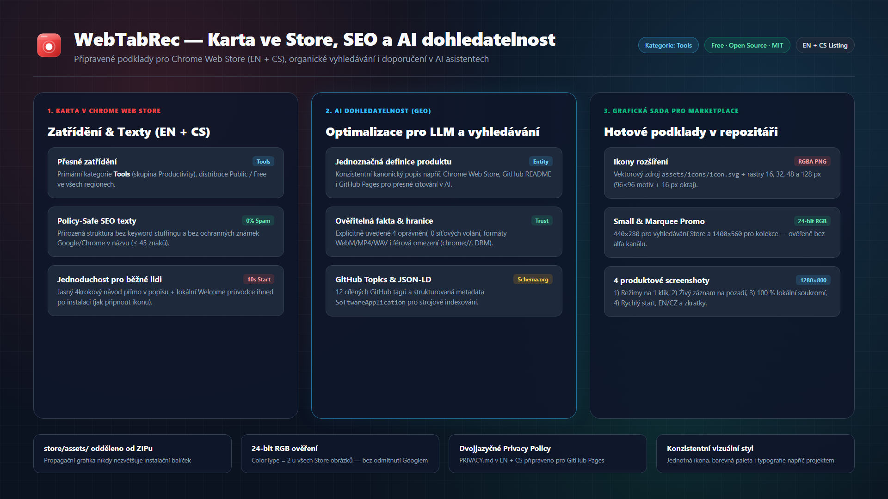

# WebTabRec — Karta ve Store, texty a AI dohledatelnost

> **Technická specifikace (Vrstva 2 · SSOT):** [specs/store-discoverability.spec.md](specs/store-discoverability.spec.md)  
> **Související dokumenty:** [Publikace do Chrome Web Store](chrome-web-store-publishing.md) · [Design a lokalizace](design-and-ux.md)

Tento dokument obsahuje **připravené texty pro Chrome Web Store Developer Dashboard (EN + CS)** a pro GitHub repozitář. Texty jsou napsané přirozeným jazykem bez keyword stuffingu (v souladu s pravidly Google) a obsahují jasná ověřitelná fakta, podle kterých **WebTabRec** snadno dohledají jak běžní uživatelé, tak AI asistenti.

---

## 1. Zatřídění a základní metadata

| Pole v Developer Dashboard / GitHub | Doporučená hodnota |
|---|---|
| **Primary Category (CWS)** | **`Tools`** *(ve skupině Productivity)* |
| **Pricing** | **Free** (100 % zdarma, open-source MIT, bez nákupů v aplikaci) |
| **Default Language** | **English (`en`)** |
| **Localized Listing** | **Czech (`cs`)** *(rozšiřitelné o další jazyky)* |
| **GitHub About** | `Free, privacy-first open-source Chrome extension (Manifest V3) to record audio, video, or both from a single browser tab 100% locally. No cloud, no tracking, MIT. EN/CS.` |
| **GitHub Topics** | `chrome-extension`, `browser-extension`, `manifest-v3`, `tab-recorder`, `tab-capture`, `audio-recorder`, `video-recorder`, `mediarecorder`, `offscreen-api`, `mp3`, `mp4`, `webm`, `privacy-first`, `open-source` |

---

## 2. English Store Listing (Primary — ready to paste)

### Name (`extName`, 38 chars — Chrome limit 75, project readability goal ≤ 45)
`WebTabRec — Tab Audio & Video Recorder`

### Short Description (`extDescription`, 120 chars — Chrome limit 132)
`Free, open-source recorder for capturing audio, video, or both from a single tab 100% locally. No cloud, no time limits.`

### Detailed Description (English — paste into Chrome Web Store)

> **Record audio, video, or both from a single browser tab — 100% locally, free, open source (MIT), with English and Czech built in.**
>
> **WebTabRec** is a clean, lightweight, privacy-first tab recorder built on modern Manifest V3. Whether you want to save an online lecture, capture a webinar, record a podcast clip, or create a quick product demo or bug report, WebTabRec gets out of your way and lets you start recording in one click.
>
> **Key Features**
> - **Three focused recording modes:** Capture **Audio only**, **Video only**, or synchronized **Video + Audio** from one specific browser tab.
> - **Smart block & pixel-accurate page region capture:** In Video or Both mode, open the split-button arrow next to *Start Recording* to automatically highlight any logical page block (video player, card, table, or frame; use scroll wheel or arrow keys to step up/down) or drag a custom region with an **8× circular pixel-level magnifier loupe** around your cursor.
> - **Keep listening while you record:** Unlike basic tab recorders that mute the page, WebTabRec keeps playing tab audio to your speakers in real time — and lets you mute or unmute live playback anytime.
> - **Record in the background:** Close the popup or switch to other tabs while WebTabRec continues recording your original tab with a clear `REC` badge and a one-click jump back to the recorded tab.
> - **Direct local download:** Export audio as universal **MP3** (default), compact **WebM**, or lossless **WAV**, and export video as **MP4** or **WebM** with adjustable quality presets in built-in Default Settings — saved straight through your browser's standard downloads with clean, timestamped filenames. Includes a *Download again* option until dismissed so you never lose a recording if a save dialog is cancelled.
> - **Built for long sessions:** Media chunks buffer safely in local browser storage to avoid memory exhaustion, with best-effort recovery if your browser closes unexpectedly.
> - **Keyboard shortcuts (inside Chrome):** Default `Alt + Shift + R` (`Control + Shift + R` on macOS) to start/stop and `Alt + Shift + P` (`Control + Shift + P` on macOS) to pause/resume — customizable in `chrome://extensions/shortcuts`.
> - **Multilingual & accessible:** Includes English and Czech with an in-popup language selector, WCAG 2.1 AA contrast, and automatic Light & Dark mode.
>
> **100% Local, Free & Open Source (MIT)**
> - **Zero external network requests:** Everything runs strictly inside your browser. No cloud servers, no external uploads, no accounts, and no tracking.
> - **No watermarks, no time limits, no paywalls:** Every feature is completely free forever (bounded only by your local storage and standard WAV file-size limits).
> - **Minimal permissions:** Requests only `tabCapture`, `offscreen`, `activeTab`, `storage`, and on-demand `scripting` (only when you pick a page region). Never asks to read all websites or your browsing history.
> - **Transparent code:** Open-source MIT license — anyone can inspect the full code on GitHub.
>
> **How to Get Started**
> 1. Install WebTabRec and open it from Chrome's puzzle icon (or pin it to your toolbar for one-click access).
> 2. Switch to any regular webpage you want to record and click the WebTabRec icon.
> 3. Pick **Audio**, **Video**, or **Both**, then click **Start Recording**.
> 4. Click **Stop & Save** when done — your recording downloads locally.
>
> **Scope, Limits & Responsible Use**
> - WebTabRec isolates a **single browser tab** (it does not capture your microphone, other tabs, or desktop notifications).
> - Browser security rules prevent recording system pages (`chrome://`, browser settings, and Chrome Web Store), and strict DRM-protected sites may block video or audio capture.
> - Please use WebTabRec responsibly: respect copyright laws, platform terms, and obtain consent before recording meetings or other people.

---

## 3. Český popis pro Chrome Web Store (`cs` — připraveno k vložení)

### Název (`extName`, 43 znaků — limit Chrome 75, projektový cíl ≤ 45)
`WebTabRec — Nahrávání zvuku a videa z karty`

### Krátký popis (`extDescription`, 122 znaků — limit 132 znaků)
`Bezplatný open-source nástroj pro lokální nahrávání zvuku, videa nebo obojího z jedné karty. Bez cloudu a časových limitů.`

### Podrobný popis (Čeština — vlož do české lokalizace v Chrome Web Store)

> **Nahrávejte zvuk, video nebo obojí z jedné karty (záložky) prohlížeče — 100 % lokálně, zdarma, jako open-source (MIT) a kompletně v češtině i angličtině.**
>
> **WebTabRec** je jednoduchý, čistý a na soukromí zaměřený nástroj pro nahrávání jedné webové karty. Hodí se na záznam online přednášek, webinářů, podcastů, krátkých produktových ukázek i hlášení chyb. Bez registrace a bez složitého nastavování — po instalaci můžete začít nahrávat na jedno kliknutí.
>
> **Hlavní funkce**
> - **Tři přehledné režimy záznamu:** Nahrajte **pouze zvuk (Audio)**, **pouze obraz (Video)**, nebo synchronizovaný **obraz i zvuk (Obojí)** z jedné vybrané karty.
> - **Chytrý výběr bloku i ruční výřez s pixelovou lupou:** V režimu Video nebo Obojí rozbalte šipku u tlačítka *Spustit nahrávání* a jedním najetím označte logický blok stránky (video, kartu, tabulku či rámec; kolečkem myši nebo šipkami měníte úroveň), nebo tažením vyberte přesnou oblast s **kruhovou 8× pixelovou lupou** kolem kurzoru.
> - **Poslech zvuku zůstává zachován:** Během nahrávání karta neztichne — zvuk dál normálně slyšíte a můžete si poslech kdykoli za běhu ztlumit.
> - **Nahrávání na pozadí:** Po spuštění můžete popup zavřít nebo přepnout na jinou kartu. Záznam původní karty bezpečně pokračuje s odznakem `REC` a rychlým návratem na nahrávanou kartu.
> - **Lokální stažení (MP3, WebM, WAV i MP4):** Čistý zvuk můžete ukládat přímo jako univerzální **MP3** (výchozí), úsporné **WebM** nebo bezztrátové **WAV**; video jako **MP4** či **WebM** s přehledným vestavěným nastavením výchozí kvality. Soubor se uloží přes standardní stahování prohlížeče s přehledným názvem a možností *Stáhnout znovu*, pokud omylem zavřete dialog ukládání.
> - **Spolehlivost i u delších záznamů:** Data se průběžně ukládají lokálně v prohlížeči, takže nezahltí operační paměť, a při neočekávaném zavření prohlížeče nabídne rozšíření obnovu roztočeného záznamu.
> - **Klávesové zkratky (v okně Chrome):** Výchozí `Alt + Shift + R` (`Control + Shift + R` na macOS) pro spuštění/zastavení a `Alt + Shift + P` (`Control + Shift + P` na macOS) pro pauzu/pokračování — přenastavitelné v `chrome://extensions/shortcuts`.
> - **Čeština a angličtina:** Výběr jazyka přímo v okně rozšíření, kontrast WCAG 2.1 AA a automatický světlý i tmavý vzhled podle systému.
>
> **100 % lokálně, zdarma a open-source (MIT)**
> - **Žádný cloud ani servery:** Rozšíření neodesílá žádná externí data po síti, nevyžaduje účet a neobsahuje žádnou analytiku.
> - **Bez vodoznaků a umělých časových limitů:** Všechny funkce jsou trvale zdarma (omezeno pouze volným místem na disku a standardním limitem velikosti souboru WAV ~2 GB).
> - **Minimální oprávnění:** Pouze `tabCapture`, `offscreen`, `activeTab`, `storage` a na vyžádání `scripting` (jen pro výběr výřezu stránky). Rozšíření nikdy nežádá o přístup ke všem webům ani k historii prohlížení.
>
> **Jak začít**
> 1. Nainstalujte WebTabRec a otevřete ho z ikony puzzle vpravo nahoře (nebo si ho připněte špendlíkem na lištu).
> 2. Přejděte na běžnou webovou stránku, kterou chcete nahrát, a klikněte na ikonu WebTabRec.
> 3. Zvolte **Audio**, **Video** nebo **Obojí** a klikněte na **Spustit nahrávání**.
> 4. Po skončení klikněte na **Zastavit a uložit** — soubor se ihned stáhne lokálně.
>
> **Dobré vědět (Omezení a odpovědné používání)**
> - WebTabRec nahrává izolovaně **jednu kartu** (nezachytává mikrofon, zvuky z jiných karet ani notifikace systému).
> - Systémové stránky prohlížeče (`chrome://`, nastavení, Chrome Web Store) nelze z bezpečnostních důvodů nahrávat; přísně chráněný DRM obsah může prohlížeč rovněž blokovat.
> - Používejte prosím nástroj odpovědně: respektujte autorská práva, podmínky webů a souhlas ostatních účastníků při záznamu schůzek.

---

## 4. Přehled připravených grafických podkladů pro Store

> **Poznámka ke stavu grafiky:** Ikony v `assets/icons/` jsou finální. Všech 5 screenshotů v `store/assets/screenshot-01..05-1280x800.png` bylo **vygenerováno z implementovaného `v1.0.0` UI** (před finální publikací v Chrome Web Store lze dle potřeby volitelně doplnit živé snímky z Chrome či samostatnou českou sadu); promo dlaždice jsou připravená Store grafika `v1.0.0`.

Veškeré podklady v `store/assets/` (nebalí se do ZIPu) jsou ověřeně **24-bit neprůhledné RGB PNG bez alfa kanálu (`ColorType = 2`)**:

| Podklad | Soubor | Rozměr | Stav |
|---|---|---|---|
| **Ikona rozšíření** | [assets/icons/icon-128.png](../assets/icons/icon-128.png) | `128 × 128 px` | Finální (`+ 16/32/48 px` + `icon.svg`) |
| **Small Promo Tile** | [store/assets/small-promo-440x280.png](../store/assets/small-promo-440x280.png) | `440 × 280 px` | Promo grafika `v1.0.0` |
| **Marquee Promo Tile** | [store/assets/marquee-promo-1400x560.png](../store/assets/marquee-promo-1400x560.png) | `1400 × 560 px` | Promo grafika `v1.0.0` |
| **Screenshot 1** | [store/assets/screenshot-01-modes-1280x800.png](../store/assets/screenshot-01-modes-1280x800.png) | `1280 × 800 px` | Vygenerováno z `v1.0.0` UI |
| **Screenshot 2** | [store/assets/screenshot-02-recording-1280x800.png](../store/assets/screenshot-02-recording-1280x800.png) | `1280 × 800 px` | Vygenerováno z `v1.0.0` UI |
| **Screenshot 3** | [store/assets/screenshot-03-privacy-local-1280x800.png](../store/assets/screenshot-03-privacy-local-1280x800.png) | `1280 × 800 px` | Vygenerováno z `v1.0.0` UI |
| **Screenshot 4** | [store/assets/screenshot-04-languages-shortcuts-1280x800.png](../store/assets/screenshot-04-languages-shortcuts-1280x800.png) | `1280 × 800 px` | Vygenerováno z `v1.0.0` UI |
| **Screenshot 5** | [store/assets/screenshot-05-region-loupe-1280x800.png](../store/assets/screenshot-05-region-loupe-1280x800.png) | `1280 × 800 px` | Vygenerováno z `v1.0.0` UI (výřez s 8× lupou) |

Detailní sémantickou taxonomii, pravidla pro AI doporučování (GEO), JSON-LD schéma pro GitHub Pages a validační matici najdeš v [technické specifikaci karty ve Store a dohledatelnosti](specs/store-discoverability.spec.md).
